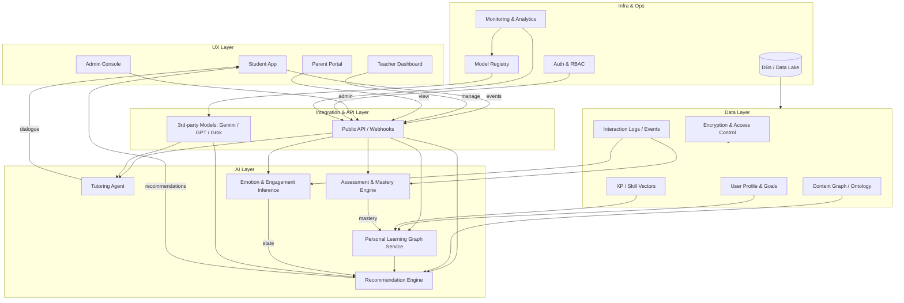
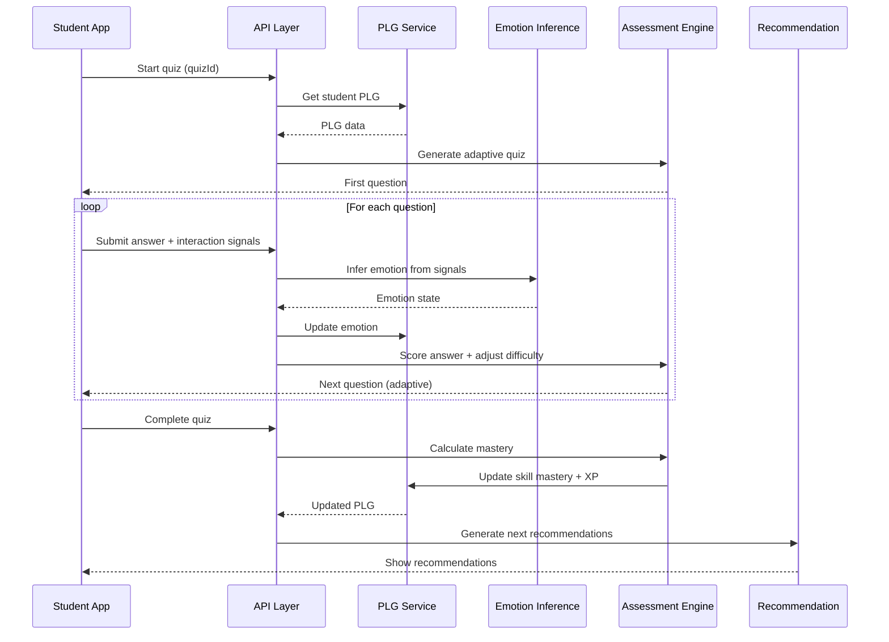
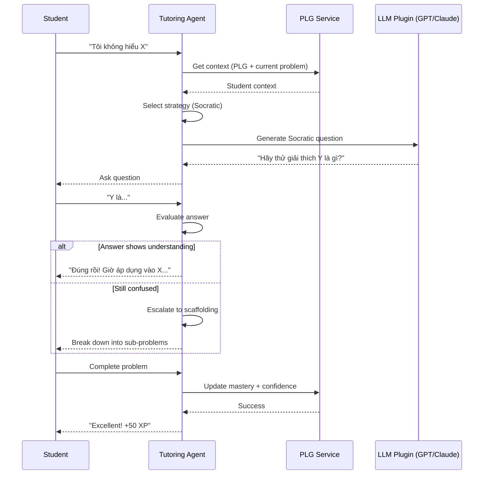

# 🚀 AI-Driven Education - System Architecture

**Version**: 2.0  
**Date**: October 19, 2025  
**Status**: 🏗️ Implementation Roadmap

---

## 🎯 Vision

Xây dựng một **Learning OS** - hệ điều hành học tập với AI làm trung tâm, nơi mọi quyết định về nội dung, độ khó, phương pháp học đều được cá nhân hóa dựa trên Personal Learning Graph của từng học sinh.

---

## 📐 System Architecture



---

## 🏗️ Core Components

### 1. 🧠 Personal Learning Graph (PLG) - **LÕI HỆ THỐNG**

**Vai trò**: "Bộ não" của từng học sinh - lưu trữ biểu diễn năng lực, thói quen, hứng thú.

**Data Model**:
```typescript
interface PersonalLearningGraph {
  studentId: string;
  
  // Skill Graph
  skills: SkillNode[];
  masteryLevels: Map<string, MasteryLevel>;
  
  // Learning Behavior
  learningStyle: 'visual' | 'auditory' | 'kinesthetic' | 'mixed';
  preferredPace: 'slow' | 'normal' | 'fast';
  attentionSpan: number; // minutes
  
  // Emotional State
  currentEmotion: EmotionState;
  emotionHistory: EmotionTimeline[];
  
  // Performance Vectors
  xpVectors: {
    logic: number;
    memory: number;
    creativity: number;
    persistence: number;
    collaboration: number;
  };
  
  // Temporal Data
  streaks: StreakData;
  lastActive: Date;
  timezonePreference: string;
  
  // Goals & Preferences
  goals: LearningGoal[];
  interests: string[];
  avoidTopics: string[];
}

interface SkillNode {
  id: string;
  name: string;
  mastery: number; // 0-100
  lastPracticed: Date;
  decayRate: number; // Forgetting curve
  prerequisites: string[];
  attempts: AttemptHistory[];
  confidence: number; // Self-reported
}

interface MasteryLevel {
  level: 'beginner' | 'intermediate' | 'advanced' | 'expert';
  score: number;
  lastAssessed: Date;
  needsRefresh: boolean;
}

interface EmotionState {
  primary: 'excited' | 'focused' | 'frustrated' | 'tired' | 'bored' | 'confused';
  intensity: number; // 0-1
  timestamp: Date;
  inferredFrom: string[]; // ['typing_speed', 'hesitation', 'quiz_retry']
}
```

**Key Features**:
- ✅ **Skill Decay**: Tự động giảm mastery theo thời gian (forgetting curve)
- ✅ **Multi-dimensional XP**: Không chỉ điểm số, mà là vector năng lực
- ✅ **Emotion-aware**: Tích hợp trạng thái cảm xúc vào quyết định
- ✅ **Temporal Intelligence**: Biết khi nào học sinh học tốt nhất

**API Endpoints**:
```
GET  /api/plg/:studentId
POST /api/plg/:studentId/update-skill
POST /api/plg/:studentId/update-emotion
GET  /api/plg/:studentId/recommendations
POST /api/plg/:studentId/record-interaction
```

---

### 2. 🎯 Recommendation Engine

**Vai trò**: Quyết định "Học gì? Khi nào? Như thế nào?"

**Logic**:
```typescript
interface RecommendationRequest {
  studentId: string;
  context: {
    currentTime: Date;
    sessionDuration: number; // minutes available
    deviceType: 'mobile' | 'desktop' | 'tablet';
    location: 'home' | 'school' | 'public';
  };
}

interface Recommendation {
  content: ContentItem;
  reasoning: string;
  priority: number;
  estimatedDuration: number;
  format: 'video' | 'text' | 'interactive' | 'quiz' | 'game';
  difficulty: number; // 0-100
  tags: string[];
}

function generateRecommendations(
  plg: PersonalLearningGraph,
  context: RecommendationRequest
): Recommendation[] {
  const scores: Recommendation[] = [];
  
  // 1. Spaced Repetition: Skills cần ôn tập
  const needsReview = plg.skills.filter(s => 
    shouldReview(s, context.currentTime)
  );
  
  // 2. Zone of Proximal Development: Không quá dễ, không quá khó
  const zpd = plg.skills.filter(s => 
    s.mastery >= 40 && s.mastery <= 70
  );
  
  // 3. Emotion-aware: Nếu tired → easy content, excited → challenge
  const emotionAdjustment = adjustForEmotion(plg.currentEmotion);
  
  // 4. Time-aware: 15 phút → micro-lesson, 60 phút → deep dive
  const timeAdjustment = adjustForTime(context.sessionDuration);
  
  // 5. Learning Style: Visual learner → video, kinesthetic → interactive
  const stylePreference = plg.learningStyle;
  
  // Scoring algorithm
  for (const content of contentDatabase) {
    let score = 0;
    
    // Review priority
    if (needsReview.includes(content.skill)) score += 50;
    
    // ZPD alignment
    if (zpd.includes(content.skill)) score += 30;
    
    // Emotion fit
    score += emotionAdjustment(content);
    
    // Time fit
    if (content.duration <= context.sessionDuration) score += 20;
    
    // Style preference
    if (content.format === getPreferredFormat(stylePreference)) score += 15;
    
    // Interest alignment
    if (plg.interests.some(i => content.tags.includes(i))) score += 10;
    
    scores.push({ content, score, reasoning: generateReasoning(...) });
  }
  
  return scores.sort((a, b) => b.score - a.score).slice(0, 10);
}
```

**Features**:
- ✅ **Spaced Repetition**: Hermann Ebbinghaus forgetting curve
- ✅ **Zone of Proximal Development** (Vygotsky)
- ✅ **Emotion-adaptive**: Thay đổi độ khó theo cảm xúc
- ✅ **Context-aware**: Device, time, location
- ✅ **Multi-criteria scoring**: Không chỉ 1 yếu tố

---

### 3. 🤖 Tutoring Agent (Learning Dialogue)

**Vai trò**: AI tutor cá nhân hóa, gợi ý, scaffolding, hinting.

**Strategies**:
```typescript
interface DialogueStrategy {
  name: string;
  trigger: (context: TutoringContext) => boolean;
  execute: (context: TutoringContext) => DialogueAction;
}

const strategies: DialogueStrategy[] = [
  // Socratic Method: Hỏi để dẫn dắt tư duy
  {
    name: 'socratic',
    trigger: (ctx) => ctx.studentConfused && !ctx.gaveUpYet,
    execute: (ctx) => ({
      type: 'question',
      text: generateSocraticQuestion(ctx.topic, ctx.studentAnswer),
      hint: false
    })
  },
  
  // Scaffolding: Chia nhỏ vấn đề
  {
    name: 'scaffolding',
    trigger: (ctx) => ctx.problemTooHard,
    execute: (ctx) => ({
      type: 'breakdown',
      text: 'Hãy chia bài toán thành 3 bước nhỏ...',
      subproblems: breakdownProblem(ctx.problem)
    })
  },
  
  // Hinting: Gợi ý nhẹ
  {
    name: 'progressive_hints',
    trigger: (ctx) => ctx.stuckTime > 2 * 60, // 2 minutes
    execute: (ctx) => ({
      type: 'hint',
      level: ctx.hintLevel, // 1-4, tăng dần
      text: generateHint(ctx.problem, ctx.hintLevel)
    })
  },
  
  // Worked Example: Giải mẫu tương tự
  {
    name: 'worked_example',
    trigger: (ctx) => ctx.hintLevel >= 3 && ctx.stillStuck,
    execute: (ctx) => ({
      type: 'example',
      text: 'Để hiểu rõ hơn, xem bài tương tự...',
      example: findSimilarWorkedExample(ctx.problem)
    })
  },
  
  // Encouragement: Động viên
  {
    name: 'encouragement',
    trigger: (ctx) => ctx.emotion === 'frustrated',
    execute: (ctx) => ({
      type: 'encouragement',
      text: generateEncouragement(ctx.recentProgress)
    })
  },
  
  // Challenge: Thử thách
  {
    name: 'challenge',
    trigger: (ctx) => ctx.emotion === 'bored' && ctx.mastery > 80,
    execute: (ctx) => ({
      type: 'challenge',
      text: 'Bạn giỏi quá! Thử bài này xem sao?',
      problem: generateHarderProblem(ctx.skill)
    })
  }
];
```

**Integration với LLM Plugins**:
```typescript
// Tutor có thể gọi GPT/Claude/Gemini cho generation
async function tutorRespond(
  studentMessage: string,
  context: TutoringContext
): Promise<TutorResponse> {
  // 1. Chọn strategy
  const strategy = selectStrategy(context);
  
  // 2. Nếu cần LLM (complex generation)
  if (strategy.needsLLM) {
    const llmResponse = await callLLMPlugin({
      model: selectBestModel('explanation'), // Intelligent selection
      prompt: buildPrompt(strategy, context, studentMessage),
      temperature: 0.7,
      maxTokens: 300
    });
    
    return {
      text: llmResponse.text,
      strategy: strategy.name,
      metadata: llmResponse.meta
    };
  }
  
  // 3. Rule-based response
  return strategy.execute(context);
}
```

---

### 4. 📊 Assessment & Mastery Engine

**Vai trò**: Đo lường, đánh giá, cập nhật PLG.

**Features**:
- ✅ **Adaptive Testing**: Điều chỉnh độ khó theo câu trả lời
- ✅ **IRT (Item Response Theory)**: Tính toán true ability
- ✅ **Mastery Learning**: 80% để pass, không là ôn lại
- ✅ **Multi-modal Assessment**: Quiz, project, oral, simulation

**Algorithm**:
```typescript
interface AssessmentSession {
  studentId: string;
  skill: string;
  items: AssessmentItem[];
  estimatedAbility: number; // IRT theta
  confidence: number;
}

// Computerized Adaptive Testing (CAT)
function selectNextItem(
  session: AssessmentSession
): AssessmentItem {
  // Fisher Information: Chọn câu hỏi có thông tin nhiều nhất
  const candidates = itemBank.filter(item => 
    !session.items.includes(item)
  );
  
  const scored = candidates.map(item => ({
    item,
    information: fisherInformation(
      item.difficulty,
      session.estimatedAbility
    )
  }));
  
  return scored.sort((a, b) => 
    b.information - a.information
  )[0].item;
}

// IRT: Item Response Theory
function fisherInformation(
  itemDifficulty: number,
  studentAbility: number
): number {
  const p = probabilityCorrect(itemDifficulty, studentAbility);
  return p * (1 - p); // Maximum at p = 0.5
}

function probabilityCorrect(
  b: number, // item difficulty
  theta: number // student ability
): number {
  return 1 / (1 + Math.exp(-(theta - b)));
}
```

---

### 5. 😊 Emotion & Engagement Inference

**Vai trò**: Suy đoán trạng thái cảm xúc từ tương tác.

**Signals**:
```typescript
interface InteractionSignals {
  // Typing behavior
  typingSpeed: number; // chars/second
  typingPauses: number[]; // pause durations
  deletions: number; // backspace count
  
  // Mouse/Touch
  mousePath: Point[]; // Erratic = confused?
  clickHesitation: number; // ms before click
  scrollSpeed: number;
  
  // Quiz behavior
  timePerQuestion: number[];
  retryCount: number;
  skipCount: number;
  
  // Video engagement
  playbackSpeed: number;
  rewindCount: number;
  dropoffTime?: number; // Quit early?
  
  // Session
  sessionDuration: number;
  tabSwitches: number; // Distraction?
  idleTime: number;
}

function inferEmotion(
  signals: InteractionSignals,
  history: EmotionTimeline[]
): EmotionState {
  let scores = {
    excited: 0,
    focused: 0,
    frustrated: 0,
    tired: 0,
    bored: 0,
    confused: 0
  };
  
  // Fast typing + low deletion = focused
  if (signals.typingSpeed > 3 && signals.deletions < 5) {
    scores.focused += 30;
  }
  
  // Slow typing + many deletions = frustrated/confused
  if (signals.typingSpeed < 1 && signals.deletions > 10) {
    scores.frustrated += 25;
    scores.confused += 15;
  }
  
  // Many retries = frustrated
  if (signals.retryCount > 3) {
    scores.frustrated += 20;
  }
  
  // Long idle = tired/bored
  if (signals.idleTime > 120) { // 2 minutes
    scores.tired += 15;
    scores.bored += 15;
  }
  
  // Many tab switches = distracted/bored
  if (signals.tabSwitches > 5) {
    scores.bored += 20;
  }
  
  // Many rewinds = confused
  if (signals.rewindCount > 3) {
    scores.confused += 25;
  }
  
  // Fast playback = bored (too easy)
  if (signals.playbackSpeed > 1.5) {
    scores.bored += 20;
  }
  
  // Find dominant emotion
  const dominant = Object.entries(scores)
    .sort(([, a], [, b]) => b - a)[0];
  
  return {
    primary: dominant[0] as any,
    intensity: dominant[1] / 100,
    timestamp: new Date(),
    inferredFrom: Object.keys(signals)
  };
}
```

---

### 6. 🗺️ Content Graph (Knowledge Ontology)

**Vai trò**: Biểu diễn knowledge domain, prerequisites, relationships.

**Structure**:
```typescript
interface ContentGraph {
  nodes: ConceptNode[];
  edges: ConceptEdge[];
}

interface ConceptNode {
  id: string;
  name: string;
  description: string;
  domain: 'math' | 'physics' | 'chemistry' | 'biology' | 'cs';
  level: 'elementary' | 'middle' | 'high' | 'college';
  
  // Bloom's Taxonomy
  cognitiveLevel: 'remember' | 'understand' | 'apply' | 'analyze' | 'evaluate' | 'create';
  
  // Resources
  resources: Resource[];
  
  // Metadata
  estimatedLearningTime: number; // minutes
  difficulty: number; // 0-100
  popularity: number; // how many students learned
}

interface ConceptEdge {
  from: string; // prerequisite
  to: string; // dependent concept
  strength: 'required' | 'recommended' | 'related';
  description: string;
}

interface Resource {
  id: string;
  type: 'video' | 'text' | 'interactive' | 'quiz' | 'simulation';
  url: string;
  duration: number;
  format: string;
  language: string;
  quality: number; // 0-5 stars
  createdBy: 'ai' | 'teacher' | 'external';
}
```

**Query Examples**:
```typescript
// Find learning path from A to B
function findLearningPath(
  from: string,
  to: string,
  plg: PersonalLearningGraph
): ConceptNode[] {
  // Dijkstra with personalization
  // Consider: PLG mastery, learning style, time available
}

// Get next concepts to learn
function getNextConcepts(
  plg: PersonalLearningGraph,
  graph: ContentGraph
): ConceptNode[] {
  // All prerequisites met?
  // Not yet mastered?
  // Aligned with goals?
}
```

---

## 📊 Data Flow (Main Scenarios)

### Scenario 1: Student Làm Bài



### Scenario 2: Student Gặp Khó Khăn, AI Tutor Giúp



---

## 🛠️ Implementation Stack

### Backend:
- **Language**: TypeScript (Node.js)
- **Framework**: Next.js 15 (App Router + API Routes)
- **Database**: PostgreSQL (main) + Redis (cache)
- **ORM**: Prisma
- **Graph DB**: Neo4j (for Content Graph)
- **Vector DB**: Pinecone/Weaviate (for semantic search)
- **Queue**: BullMQ (for async processing)

### AI/ML:
- **LLM Gateway**: OpenRouter (500+ models)
- **Local Models**: Ollama (privacy-sensitive tasks)
- **Model Registry**: MLflow
- **Prompt Management**: LangChain
- **Vector Embeddings**: OpenAI text-embedding-3

### Infrastructure:
- **Auth**: NextAuth.js (multi-provider)
- **API**: tRPC (type-safe)
- **Monitoring**: Sentry + Datadog
- **Analytics**: Mixpanel + custom
- **Storage**: AWS S3 (content) + CloudFlare R2

---

## 🎯 MVP Scope (Phase 0 - Foundation)

### Core Services (4-6 weeks):

1. **PLG Service** (2 weeks):
   - [ ] Data schema design
   - [ ] CRUD API
   - [ ] Skill decay algorithm
   - [ ] XP vector calculation
   - [ ] Basic emotion tracking

2. **Recommendation Engine** (2 weeks):
   - [ ] Content scoring algorithm
   - [ ] Spaced repetition logic
   - [ ] ZPD calculation
   - [ ] Time/context awareness
   - [ ] Integration with PLG

3. **Simple Tutor** (1 week):
   - [ ] Rule-based dialogue
   - [ ] 3-4 basic strategies
   - [ ] LLM plugin integration
   - [ ] Chat UI

4. **Assessment MVP** (1 week):
   - [ ] Quiz engine
   - [ ] Basic mastery calculation
   - [ ] PLG update on completion

### UI Components (2 weeks):
- [ ] Student dashboard with recommendations
- [ ] Learning path visualization
- [ ] Tutor chat interface
- [ ] Progress tracking

---

## 📈 Phased Rollout

### Phase 1: Foundation (Weeks 1-6) ✅ Priority
- PLG Service
- Recommendation Engine
- Basic Tutor
- Assessment MVP

### Phase 2: Intelligence (Weeks 7-12)
- Emotion Inference
- Adaptive Testing (CAT + IRT)
- Content Graph
- Advanced tutoring strategies

### Phase 3: Personalization (Weeks 13-18)
- Learning style detection
- Optimal time prediction
- Multi-modal content
- Parent/Teacher dashboards

### Phase 4: Scale & Optimize (Weeks 19-24)
- Performance optimization
- Caching layer
- A/B testing framework
- Analytics & insights

---

## 💰 Cost Estimation (per 1000 students)

### AI Costs:
- **LLM calls**: ~$0.01/student/day = $10/day
- **Embeddings**: ~$0.001/student/day = $1/day
- **Total AI**: ~$330/month for 1000 students

### Infrastructure:
- **Database**: ~$100/month (PostgreSQL + Redis)
- **Storage**: ~$50/month (S3 + CloudFlare)
- **Compute**: ~$200/month (Next.js + workers)
- **Total Infra**: ~$350/month

**Grand Total**: ~$680/month for 1000 students = **$0.68/student/month**

With intelligent caching (77% savings): **$0.25/student/month**

---

## 🔐 Security & Privacy

### Data Protection:
- ✅ Encryption at rest (AES-256)
- ✅ Encryption in transit (TLS 1.3)
- ✅ Field-level encryption for sensitive data
- ✅ RBAC (Role-Based Access Control)
- ✅ Data anonymization for analytics
- ✅ GDPR-compliant (export/erase)

### AI Ethics:
- ✅ Explainable recommendations
- ✅ Bias detection & mitigation
- ✅ Human oversight (teacher review)
- ✅ Opt-out options
- ✅ Transparent data usage

---

## 📚 Next Steps

1. **Immediate** (This Week):
   - [ ] Design PLG schema in Prisma
   - [ ] Create PLG API routes
   - [ ] Implement basic recommendation algorithm
   - [ ] Update existing AI system to use PLG

2. **Short-term** (Next 2 Weeks):
   - [ ] Build Content Graph
   - [ ] Implement spaced repetition
   - [ ] Create tutor dialogue system
   - [ ] Add emotion inference (basic)

3. **Medium-term** (Next Month):
   - [ ] Full adaptive testing
   - [ ] Advanced tutoring strategies
   - [ ] Teacher dashboard integration
   - [ ] Analytics & monitoring

---

## 🎊 Conclusion

Đây là một **kiến trúc enterprise-grade** cho AI-driven education. 

**Key Differentiators**:
1. **PLG-centric**: Mọi thứ xoay quanh Personal Learning Graph
2. **Emotion-aware**: AI hiểu cảm xúc học sinh
3. **Multi-modal**: Video, text, interactive, game
4. **Scientifically-grounded**: IRT, spaced repetition, ZPD
5. **Plugin-friendly**: Dễ tích hợp LLM mới

**Ready to build the future of education!** 🚀

---

**Document Version**: 2.0  
**Last Updated**: October 19, 2025  
**Status**: 📋 Roadmap Ready

