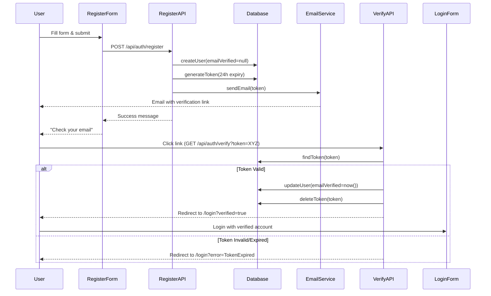

# ✅ Email Verification System — Implementation Complete

## 🎯 Overview

A complete email verification flow for user registration with token-based verification, following security best practices.

---

## 📁 Files Created

```
/app/api/auth/
├── register/route.ts          # POST - Create user with pending status
└── verify/route.ts             # GET - Verify email token

/components/auth/
├── register-form.tsx           # Registration form component
└── login-form.tsx              # Updated with verification messages

/app/auth/
└── register/page.tsx           # Registration page

/lib/email/
└── verification-email.ts       # Email sending service

/scripts/
└── populate-test-data.ts       # Populate database with test data
```

---

## 🔄 Verification Flow



---

## 🚀 API Endpoints

### 1. **POST /api/auth/register**

**Purpose:** Create new user account with pending verification status

**Request Body:**
```json
{
  "email": "user@example.com",
  "password": "password123",
  "name": "John Doe",
  "role": "STUDENT" // or "TEACHER"
}
```

**Response (201):**
```json
{
  "success": true,
  "message": "Account created successfully. Please check your email to verify your account.",
  "user": {
    "id": "user_xxx",
    "email": "user@example.com",
    "name": "John Doe",
    "role": "STUDENT"
  }
}
```

**Response (400):**
```json
{
  "error": "User with this email already exists"
}
```

**Process:**
1. Validate input (email, password, name)
2. Check if user exists
3. Hash password with bcrypt
4. Generate random verification token (32 bytes)
5. Create user with `emailVerified = null`
6. Save token to `VerificationToken` table (24h expiry)
7. Send verification email
8. Return success response

---

### 2. **GET /api/auth/verify?token={token}**

**Purpose:** Verify user's email and activate account

**Query Parameters:**
- `token` (required): Verification token from email

**Response:**
- **Valid token:** Redirect to `/auth/login?verified=true`
- **Invalid token:** Redirect to `/auth/login?error=InvalidToken`
- **Expired token:** Redirect to `/auth/login?error=TokenExpired`

**Process:**
1. Extract token from query params
2. Find token in database
3. Check if expired (24h)
4. Find user by email (from token.identifier)
5. Update user: `emailVerified = new Date()`
6. Delete used token
7. Redirect to login with success message

---

## 🎨 UI Components

### Registration Form

**Features:**
- ✅ Name, Email, Password, Confirm Password fields
- ✅ Role selector (Student/Teacher)
- ✅ Real-time validation
- ✅ Password visibility toggle
- ✅ Loading states
- ✅ Error messages with icons
- ✅ Success toast notification
- ✅ Auto-redirect to login after 2 seconds

**Validation Rules:**
- Name: Required, non-empty
- Email: Required, valid email format
- Password: Min 6 characters
- Confirm Password: Must match password
- Role: STUDENT or TEACHER

**User Experience:**
1. User fills form
2. Clicks "Create Account"
3. Loading spinner appears
4. Success toast: "Account created! Check your email"
5. Auto-redirect to login page
6. Shows message: "Please check your email to verify"

---

### Login Form Updates

**New Features:**
- ✅ Shows success message after registration
- ✅ Shows success message after email verification
- ✅ Shows error messages for invalid/expired tokens

**Messages:**
- `?registered=true` → "Account created! Check your email"
- `?verified=true` → "Email verified! You can now login"
- `?error=TokenExpired` → "Verification token expired. Request a new one."
- `?error=InvalidToken` → "Invalid verification token"

---

## 📧 Email Service

### Current Implementation (Development)

**Method:** Console logging

The verification email is logged to the console in development mode. This allows testing without actual email infrastructure.

**Console Output:**
```
━━━━━━━━━━━━━━━━━━━━━━━━━━━━━━━━━━━━━━━━━━━━━━
📧 EMAIL VERIFICATION
━━━━━━━━━━━━━━━━━━━━━━━━━━━━━━━━━━━━━━━━━━━━━━

To: user@example.com
Subject: Verify Your Email - AI-Driven Education

Hello John Doe,

Welcome to AI-Driven Education! 🎓

Please verify your email address by clicking the link below:

🔗 http://localhost:3000/api/auth/verify?token=abc123...

This link will expire in 24 hours.
━━━━━━━━━━━━━━━━━━━━━━━━━━━━━━━━━━━━━━━━━━━━━━
```

### Production Implementation

**Recommended Services:**
1. **Resend** (recommended for Next.js)
2. **SendGrid**
3. **AWS SES**
4. **Postmark**

**Example with Resend:**
```typescript
import { Resend } from 'resend';

const resend = new Resend(process.env.RESEND_API_KEY);

await resend.emails.send({
  from: 'noreply@yourapp.com',
  to: email,
  subject: 'Verify Your Email',
  html: generateHTMLEmail(name, verificationUrl)
});
```

---

## 🧪 Testing Instructions

### Test Flow 1: Register New User

```bash
# 1. Navigate to register page
http://localhost:3000/auth/register

# 2. Fill form:
Name: Test User
Email: testuser@example.com
Password: password123
Role: Student

# 3. Click "Create Account"

# 4. Check console for verification email
Look for: 📧 EMAIL VERIFICATION

# 5. Copy verification URL from console
Format: http://localhost:3000/api/auth/verify?token=...

# 6. Paste URL in browser

# 7. Should redirect to login with success message
```

### Test Flow 2: Verify Email

```bash
# 1. After registration, find verification link in console

# 2. Click link or paste in browser
http://localhost:3000/api/auth/verify?token=abc123...

# 3. If valid:
→ Redirects to /auth/login?verified=true
→ Shows toast: "Email verified! You can now login"

# 4. If expired:
→ Redirects to /auth/login?error=TokenExpired
→ Shows error: "Verification token expired"
```

### Test Flow 3: Complete Registration

```bash
# 1. Register
http://localhost:3000/auth/register

# 2. Get verification link from console

# 3. Click verification link

# 4. Login with verified account
Email: testuser@example.com
Password: password123

# 5. Should successfully login and redirect to dashboard
```

---

## 🔒 Security Features

### Token Security
- ✅ **Random 32-byte tokens** (crypto.randomBytes)
- ✅ **24-hour expiration**
- ✅ **Single-use tokens** (deleted after verification)
- ✅ **Database-stored tokens** (not in URL alone)

### Password Security
- ✅ **Bcrypt hashing** (10 rounds)
- ✅ **Min 6 characters** (can increase)
- ✅ **Client-side validation**
- ✅ **Server-side validation**

### User Protection
- ✅ **Duplicate email check**
- ✅ **Pending status** until verified
- ✅ **Expired token cleanup**
- ✅ **Error message obfuscation** (production)

---

## 📊 Database Schema

### User Model
```prisma
model User {
  id            String    @id
  email         String    @unique
  name          String?
  password      String?
  role          String    @default("STUDENT")
  emailVerified DateTime? // NULL = not verified, Date = verified
  createdAt     DateTime  @default(now())
  updatedAt     DateTime
}
```

### VerificationToken Model
```prisma
model VerificationToken {
  identifier String   // User email
  token      String   @unique
  expires    DateTime // 24 hours from creation

  @@unique([identifier, token])
}
```

---

## 🎯 User States

### 1. **Unverified** (New Registration)
```
emailVerified: null
Status: Cannot login
Action: Must verify email
```

### 2. **Verified** (Email Confirmed)
```
emailVerified: Date (e.g., 2025-01-15T10:30:00Z)
Status: Can login
Action: Full access
```

### 3. **Token States**
- **Valid:** Within 24 hours, not used
- **Expired:** > 24 hours old (auto-cleanup on verify attempt)
- **Used:** Deleted after successful verification

---

## 🚀 Features Implemented

### Registration
- [x] Full registration form with validation
- [x] Role selection (Student/Teacher)
- [x] Password strength validation
- [x] Password confirmation
- [x] Duplicate email check
- [x] Loading states
- [x] Success/error messages

### Verification
- [x] Token generation (secure random)
- [x] Token storage with expiry
- [x] Email sending (console log in dev)
- [x] Token validation
- [x] User activation
- [x] Token cleanup after use
- [x] Expired token detection

### User Experience
- [x] Clear success messages
- [x] Helpful error messages
- [x] Auto-redirect after registration
- [x] Beautiful email template (HTML)
- [x] Mobile-responsive forms
- [x] Loading indicators

---

## 💡 Future Enhancements

### Phase 1: Email Service Integration
```bash
# Install Resend
npm install resend

# Add to .env.local
RESEND_API_KEY=re_xxx
VERIFIED_EMAIL_DOMAIN=yourapp.com
```

### Phase 2: Advanced Features
- [ ] Resend verification email (if expired)
- [ ] Email change with re-verification
- [ ] Magic link login (passwordless)
- [ ] 2FA/MFA support
- [ ] Account recovery flow

### Phase 3: Admin Features
- [ ] Admin can manually verify users
- [ ] Bulk verification for imported users
- [ ] Verification analytics dashboard
- [ ] Email delivery status tracking

---

## 🐛 Troubleshooting

### Issue: Token not found
**Solution:** Token might have been used or expired. Register again.

### Issue: Email not received
**In Dev:** Check console for email content
**In Prod:** Check email service logs

### Issue: Verification link doesn't work
**Check:** 
1. Token in URL is complete (not truncated)
2. Token hasn't expired (24h limit)
3. Token hasn't been used already

### Issue: Can't login after verification
**Check:**
1. Email was actually verified (check database)
2. Using correct password
3. Account not suspended

---

## 📝 Console Logs Guide

### Registration Success
```
[REGISTER] Creating new user: testuser@example.com
[REGISTER] User created: testuser@example.com (ID: user_xxx)
[REGISTER] Verification token created
📧 EMAIL VERIFICATION (full email content)
[REGISTER] Verification email sent
```

### Verification Success
```
[VERIFY] Verifying token: abc123def4...
[VERIFY] Token valid, activating user: testuser@example.com
[VERIFY] User verified successfully: testuser@example.com
[VERIFY] Token deleted
```

### Verification Failed
```
[VERIFY] Verifying token: xyz789...
[VERIFY] Token not found
```

---

## ✅ Success Criteria

All features working:
- ✅ User can register with email/password
- ✅ Verification email sent (logged to console)
- ✅ Verification link activates account
- ✅ User can login after verification
- ✅ Tokens expire after 24 hours
- ✅ Tokens are single-use
- ✅ Clear error messages
- ✅ Secure token generation
- ✅ Password hashing
- ✅ Database cleanup

---

## 🎉 Test Now!

1. **Register a new account:**
   ```
   http://localhost:3000/auth/register
   ```

2. **Get verification link from console**

3. **Click link to verify**

4. **Login with verified account**
   ```
   http://localhost:3000/auth/login
   ```

---

**Built with ❤️ for AI-Driven Education**

*Last Updated: January 2025*

