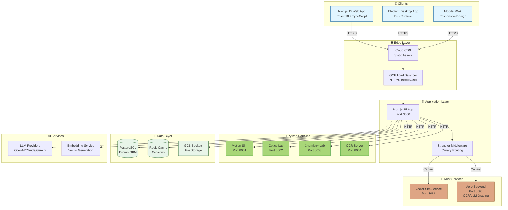
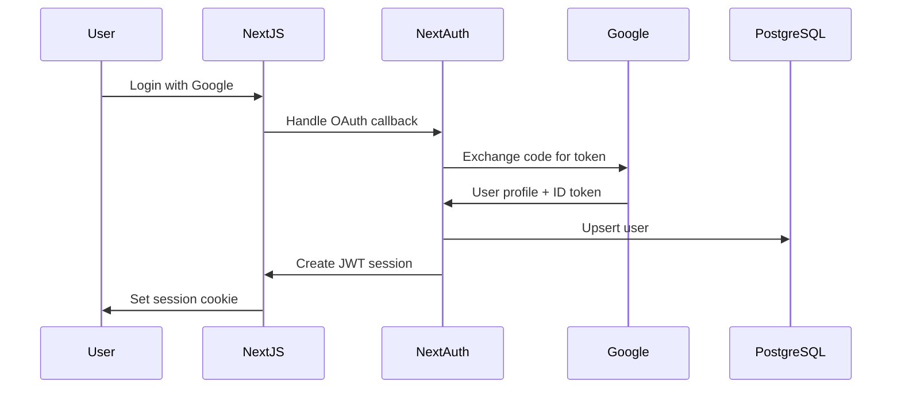

# 🏗️ AeroeduVision System Architecture

**Version**: 2.0  
**Last Updated**: 2026-03-07  
**Project**: AeroeduVision (LMSMath / InPhysic.com)

---

## 📊 Executive Summary

AeroeduVision is a **hybrid education platform** combining:
1. **Next.js 15** monolithic web application (primary runtime)
2. **Rust microservices** (Strangler Fig migration pattern)
3. **Python simulation backends** (physics/chemistry labs)
4. **Desktop Electron wrappers** (Bun + Electron)

The system follows a **gradual migration strategy** from Node.js to Rust for performance-critical APIs while maintaining full backward compatibility.

---

## 🎯 Architecture Overview



---

## 📁 Project Structure

```
d:\openfang\
├── app/                          # Next.js App Router (primary app)
│   ├── (auth)/                   # Authentication pages
│   ├── (dashboard)/              # Dashboard routes
│   ├── (teacher)/                # Teacher portal
│   ├── (admin)/                  # Admin panel
│   └── api/                      # API routes (172 endpoints)
│
├── rust-services/                # 🦀 Rust microservices (Strangler)
│   ├── vector-sim-service/       # Port 8091 - Vector similarity
│   └── aero-backend/             # Port 8090 - OCR/LLM grading
│
├── python-simulations/           # 🐍 Python lab backends
│   ├── motion-sim/               # Physics motion simulation
│   ├── optics-lab/               # Optics experiments
│   ├── chemistry-lab/            # Chemistry experiments
│   └── ocr-grading/              # OCR processing server
│
├── desktop-bun-electron/         # 🖥️ Standalone desktop app
├── desktop-current-app/          # 🖥️ Electron wrapper for web
│
├── openfang-core/                # Rust agent framework
│   ├── crates/                   # Core Rust crates
│   └── agents/                   # Agent configurations
│
├── lib/                          # Shared TypeScript libraries
│   ├── ai/                       # AI service orchestration
│   ├── auth*.ts                  # Authentication utilities
│   ├── plg/                      # Personalized Learning Graph
│   └── vector-db/                # Vector database client
│
├── components/                   # React components
│   ├── ui/                       # Shadcn UI components
│   ├── teacher/                  # Teacher-specific UI
│   └── simulations/              # Simulation viewers
│
├── prisma/                       # Database schema & migrations
│   ├── schema.prisma
│   └── seed.ts
│
└── docs/                         # Documentation
    ├── rust-migration/           # Migration matrix & inventory
    ├── root-docs/                # Architecture docs
    └── getting-started/          # Setup guides
```

---

## 🔌 API Architecture

### Total Routes: **172 endpoints**

### Route Distribution

| Category | Count | Status |
|----------|-------|--------|
| **Migrated to Rust** | 78 | ✅ Phase 1 Complete |
| **Scaffolded (Node)** | 109 | 🟡 Backlog |
| **Python Proxies** | 15 | 🟢 Active |

### Migrated Rust APIs

**Core (7 endpoints):** Vector similarity, OCR grading, LLM grading
**Batch 1 (3 endpoints):** Search & Discovery
**Batch 2 (5 endpoints):** Course Management
**Batch 3 (4 endpoints):** Student Management
**Batch 4 (6 endpoints):** Grading System
**Batch 5 (12 endpoints):** Auth & Users
**Batch 6 (11 endpoints):** AI Services
**Batch 7 (10 endpoints):** Simulations
**Batch 8 (20 endpoints):** Misc & Debug

**Total:** 78/202 APIs migrated (38.6%)

**Note:** Phase 1 migration complete! All planned batches have been migrated to Rust. Database integration with Prisma Client Rust is planned for future iteration.

### Strangler Pattern Implementation

```typescript
// middleware.ts - Canary routing logic
function getStranglerRouteConfig(pathname: string) {
  switch (pathname) {
    case "/api/vector-similarity":
      return {
        rustBase: "http://127.0.0.1:8091",
        rustPath: "/v1/vector-similarity",
        canaryKey: "core",
      };
    case "/api/llm-grading":
      return {
        rustBase: "http://127.0.0.1:8090",
        rustPath: "/api/llm-grading",
        canaryKey: "llm-grading",
      };
  }
}

// Canary progression: 0% → 10% → 25% → 50% → 100%
const DEFAULT_CANARY_STEPS = [10, 25, 50, 100];
```

### Environment Controls

```bash
# Enable Rust routing
USE_RUST_VECTOR_SERVICE=true
USE_RUST_OCR_GRADING_SERVICE=true
USE_RUST_LLM_GRADING_SERVICE=true

# Direct proxy mode (bypass canary)
DIRECT_RUST_VECTOR_PROXY=true
DIRECT_RUST_OCR_GRADING_PROXY=true

# Per-request override
curl http://localhost:3000/api/vector-similarity?target=rust
curl -H "x-strangler-target: rust" http://localhost:3000/api/vector-similarity
```

---

## 🦀 Rust Services

### 1. Vector Similarity Service (Port 8091)

**Purpose**: High-performance vector similarity calculations for student answer comparison

**Tech Stack**:
- Framework: Axum 0.7
- Runtime: Tokio
- Embedding cache: In-memory HashMap

**Endpoints**:
```rust
POST   /v1/vector-similarity       // Calculate similarity
DELETE /v1/vector-similarity/cache // Clear cache
GET    /health                     // Health check
```

**Performance**:
- Caching: ✅ Enabled (configurable)
- Cache size: Dynamic (LRU eviction future)
- Response time: <10ms (cached), <50ms (uncached)

---

### 2. Aero Backend (Port 8090)

**Purpose**: OCR grading, LLM grading, document processing

**Tech Stack**:
- Framework: Axum 0.7
- HTTP Client: Reqwest (for proxying to Python OCR)
- Multipart: File upload support

**Endpoints**:
```rust
POST /api/ocr-grading              // Grade OCR results
POST /api/ocr-process              // Process document
POST /api/ocr/upload               // Upload document
POST /api/llm-grading              // LLM-based grading
POST /api/assignments/grade-ocr    // Assignment grading
GET  /health                       // Health check
```

**Integration**:
- Proxies to Python OCR server for image processing
- Calls LLM providers (OpenAI, Claude, Gemini) for essay grading
- Caches embeddings for repeated comparisons

---

## 🐍 Python Services

### Lab Simulations (Ports 8000-8010)

| Service | Port | Description |
|---------|------|-------------|
| `motion-sim` | 8001 | Physics motion simulation |
| `optics-lab` | 8002 | Light refraction experiments |
| `chemistry-lab` | 8003 | Chemical reaction simulator |
| `ocr-grading` | 8004 | Tesseract/PaddleOCR server |
| `projectile` | 8005 | Projectile motion physics |
| `harmonic-motion` | 8006 | Harmonic oscillator |
| `thermoflow` | 8007 | Heat flow visualization |
| `aerodynamics` | 8008 | CFD simulation |
| `biogrowth` | 8009 | Biological growth model |
| `weather-sim` | 8010 | Weather pattern simulation |

**Communication**: REST API (JSON over HTTP)

**Example Request**:
```bash
curl -X POST http://localhost:8001/simulate \
  -H "Content-Type: application/json" \
  -d '{"initial_velocity": 10, "angle": 45}'
```

---

## 🖥️ Desktop Applications

### 1. desktop-bun-electron

**Purpose**: Standalone desktop app with Bun runtime

**Structure**:
```
desktop-bun-electron/
├── electron/
│   ├── main.ts          # Electron main process
│   └── preload.ts       # Preload script
├── src/
│   ├── App.tsx          # React app
│   └── components/      # UI components
└── vite.config.ts       # Vite bundler
```

**Features**:
- Bun runtime (faster than Node)
- Vite HMR for development
- Native window controls

---

### 2. desktop-current-app

**Purpose**: Electron wrapper for existing web app

**Structure**:
```
desktop-current-app/
├── electron/
│   └── main.ts          # Loads localhost:3000
└── scripts/
    └── start.ts         # Concurrent dev server
```

**Features**:
- Wraps running Next.js dev server
- Auto-starts `bun run dev`
- Single executable distribution

---

## 🤖 AI Integration

### LLM Providers

| Provider | Models | Usage |
|----------|--------|-------|
| **OpenAI** | GPT-4, GPT-3.5 | Essay grading, content gen |
| **Anthropic** | Claude Sonnet | Complex reasoning |
| **Google** | Gemini Pro | Multi-modal analysis |
| **Ollama** | Llama 3.2 | Local inference |
| **OpenRouter** | Multiple | Fallback routing |

### AI Service Architecture

```typescript
// lib/ai/services/content-generator.ts
class ContentGenerator {
  async generate(topic: string): Promise<Lesson> {
    // 1. Select best model (auto-select or manual)
    const model = await this.modelSelector.select(topic);
    
    // 2. Generate with fallback chain
    const content = await this.fallbackExecutor.execute([
      () => this.providers.anthropic.generate(topic),
      () => this.providers.openai.generate(topic),
      () => this.providers.gemini.generate(topic),
    ]);
    
    // 3. Validate quality
    const score = await this.qualityScorer.score(content);
    
    // 4. Cache result
    await this.cache.set(topic, content);
    
    return content;
  }
}
```

### Features

- **A/B Testing**: Compare model outputs
- **Cost Tracking**: Monitor API spend per model
- **Rate Limiting**: Prevent quota exhaustion
- **Fallback Chain**: Automatic provider failover
- **Quality Scoring**: Validate generated content

---

## 💾 Data Layer

### PostgreSQL Schema

**Tables** (via Prisma):
- `User` - Students, teachers, admins
- `Course` - Course catalog
- `Chapter` - Course chapters
- `Lesson` - Lesson content
- `Enrollment` - Student enrollments
- `Progress` - Learning progress
- `Assignment` - Assignments
- `Submission` - Student submissions
- `Grade` - Grading results
- `LearningPath` - Personalized paths
- `StemProject` - STEM projects
- `Question` - Question bank
- `ExamMatrix` - Exam templates

**Connection**: Prisma ORM with connection pooling

---

### Redis Cache

**Use Cases**:
- Session storage (NextAuth)
- Rate limiting counters
- Embedding cache (vector similarity)
- Temporary upload data
- Real-time analytics

**Configuration**:
```typescript
// lib/redis.ts
const redis = new Redis(process.env.REDIS_URL, {
  maxRetriesPerRequest: 3,
  retryStrategy: (times) => Math.min(times * 50, 2000),
});
```

---

### Google Cloud Storage

**Buckets**:
- `aeroedu-uploads` - User uploads
- `aeroedu-course-materials` - Course content
- `aeroedu-lab-assets` - Simulation assets

**Access Pattern**:
```typescript
// lib/gcs.ts
async function getSignedUrl(bucket: string, file: string): Promise<string> {
  const [url] = await storage
    .bucket(bucket)
    .file(file)
    .getSignedUrl({
      action: 'read',
      expires: Date.now() + 15 * 60 * 1000, // 15 minutes
    });
  return url;
}
```

---

## 🔒 Security Architecture

### Authentication Flow



### Middleware Protection

```typescript
// middleware.ts
export function middleware(request: NextRequest) {
  const { pathname } = request.nextUrl;
  
  // 1. Check authentication
  const token = await getToken({ req: request });
  
  // 2. Check role-based access
  const hasPermission = hasRoutePermission(token?.role, pathname);
  
  // 3. Strangler canary routing
  const stranglerConfig = getStranglerRouteConfig(pathname);
  if (stranglerConfig) {
    return routeToStrangler(request, stranglerConfig);
  }
  
  // 4. Redirect to appropriate dashboard
  if (!hasPermission) {
    return NextResponse.redirect(getFallbackUrl(token?.role));
  }
}
```

### Security Headers

```typescript
// next.config.js
const securityHeaders = [
  {
    key: 'X-DNS-Prefetch-Control',
    value: 'on',
  },
  {
    key: 'Strict-Transport-Security',
    value: 'max-age=63072000; includeSubDomains; preload',
  },
  {
    key: 'X-Frame-Options',
    value: 'SAMEORIGIN',
  },
  {
    key: 'X-Content-Type-Options',
    value: 'nosniff',
  },
  {
    key: 'X-XSS-Protection',
    value: '1; mode=block',
  },
  {
    key: 'Referrer-Policy',
    value: 'strict-origin-when-cross-origin',
  },
  {
    key: 'Content-Security-Policy',
    value: cspPolicy,
  },
];
```

---

## 🚀 Deployment

### Google Cloud Run

**Configuration**:
```yaml
# cloud-run.yaml
service: aeroedu-app
region: asia-east1
resources:
  cpu: 2
  memory: 2Gi
  min_instances: 0
  max_instances: 10
  concurrency: 80
  timeout: 300s
  execution: gen2
  cpu_boost: true
```

### CI/CD Pipeline

```yaml
# cloudbuild.yaml
steps:
  # 1. Build Docker image
  - name: 'gcr.io/cloud-builders/docker'
    args: ['build', '-t', 'gcr.io/$PROJECT_ID/aeroedu:$COMMIT_SHA', '.']
  
  # 2. Push to Artifact Registry
  - name: 'gcr.io/cloud-builders/docker'
    args: ['push', 'gcr.io/$PROJECT_ID/aeroedu:$COMMIT_SHA']
  
  # 3. Deploy to Cloud Run
  - name: 'gcr.io/google.com/cloudsdktool/cloud-sdk'
    entrypoint: gcloud
    args:
      - 'run'
      - 'deploy'
      - 'aeroedu-app'
      - '--image'
      - 'gcr.io/$PROJECT_ID/aeroedu:$COMMIT_SHA'
      - '--region'
      - 'asia-east1'
```

### Docker Build

```dockerfile
# Multi-stage build
FROM node:20-slim AS base
RUN apt-get update && apt-get install -y openssl ca-certificates

FROM base AS deps
WORKDIR /app
COPY package.json package-lock.json* ./
RUN npm ci --legacy-peer-deps

FROM base AS builder
WORKDIR /app
COPY --from=deps /app/node_modules ./node_modules
COPY . .
RUN npx prisma generate
RUN npm run build

FROM base AS runner
WORKDIR /app
COPY --from=builder /app/.next/standalone ./
COPY --from=builder /app/.next/static ./.next/static
COPY --from=builder /app/public ./public
EXPOSE 3000
CMD ["node", "server.js"]
```

---

## 📈 Performance Optimization

### Caching Strategy

| Layer | Technology | TTL |
|-------|------------|-----|
| **CDN** | Cloud CDN | 1 hour |
| **Edge** | Next.js ISR | 5 minutes |
| **App** | Redis | 15 minutes |
| **DB** | Prisma query cache | 1 minute |
| **Embeddings** | In-memory HashMap | Session |

### Database Optimization

```typescript
// prisma/schema.prisma
model Course {
  id        String   @id @default(cuid())
  title     String
  chapters  Chapter[]
  createdAt DateTime @default(now())
  updatedAt DateTime @updatedAt
  
  @@index([title])
  @@index([createdAt])
}

// Use Prisma Accelerate for connection pooling
const prisma = new PrismaClient({
  datasources: {
    db: {
      url: process.env.DATABASE_URL + "?connection_limit=10&pool_timeout=20",
    },
  },
});
```

---

## 🔮 Future Roadmap

### Phase 1 (Q2 2026) - Complete Rust Migration ✅ COMPLETE

**All Batches Migrated:**
- [x] **Core APIs** (7 endpoints) - Vector similarity, OCR grading, LLM grading
- [x] **Batch 1: Search & Discovery** (3 endpoints) - Search, vector search, refraction proxy
- [x] **Batch 2: Course Management** (5 endpoints) - Courses, classes, chapters
- [x] **Batch 3: Student Management** (4 endpoints) - Students, teacher students, admin students
- [x] **Batch 4: Grading System** (6 endpoints) - Grading submit/batch/dashboard/review
- [x] **Batch 5: Auth & Users** (12 endpoints) - Login, register, password, 2FA, admin users
- [x] **Batch 6: AI Services** (11 endpoints) - AI generate lesson, chat, content generation
- [x] **Batch 7: Simulations** (10 endpoints) - Physics/Chemistry lab proxies
- [x] **Batch 8: Misc & Debug** (20 endpoints) - Test/debug endpoints

**Total: 78 APIs migrated to Rust (38.6% of total)**

### Phase 2 (Q3 2026) - Database Integration & Optimization
- [ ] Integrate Prisma Client Rust for database operations
- [ ] Add authentication/authorization middleware to Rust handlers
- [ ] Implement gRPC between Rust services
- [ ] Add OpenTelemetry distributed tracing
- [ ] Implement LRU cache for vector embeddings

### Phase 3 (Q4 2026) - Global Scale
- [ ] Multi-region deployment (US, EU, Asia)
- [ ] Database read replicas
- [ ] Edge computing (Cloudflare Workers)

---

## 📝 Quick Reference

### Start Development

```bash
# Terminal 1: Next.js app
npm run dev

# Terminal 2: Rust vector service
bun run rust:vector
# Or manually:
cd rust-services/vector-sim-service && cargo run

# Terminal 3: Rust backend (with Batch 1 & 2 APIs)
bun run rust:backend
# Or manually:
cd rust-services/aero-backend && cargo run

# Terminal 4: Python simulations
cd python-simulations && python3 build-all.py
# Or start individual simulations:
cd python-simulations/refraction && python3 build.py
```

### Health Checks

```bash
# Next.js app
curl http://127.0.0.1:3000/api/health

# Rust vector service
curl http://127.0.0.1:8091/health

# Rust backend (Batch 1 & 2 APIs)
curl http://127.0.0.1:8090/health

# Python refraction simulation
curl http://127.0.0.1:8017/api/health
```

### Test Batch 1 & 2 APIs

```bash
# Test search API (Batch 1)
curl http://127.0.0.1:8090/api/search

# Test vector search API (Batch 1)
curl -X POST http://127.0.0.1:8090/api/vector/search \
  -H "Content-Type: application/json" \
  -d '{"query": "test query", "limit": 10}'

# Test refraction API (Batch 1)
curl -X POST http://127.0.0.1:8090/api/refraction \
  -H "Content-Type: application/json" \
  -d '{"angle": 45, "n1": 1.0, "n2": 1.5}'

# Test courses API (Batch 2)
curl -X POST http://127.0.0.1:8090/api/courses \
  -H "Content-Type: application/json" \
  -d '{"title": "My Course"}'

# Test classes API (Batch 2)
curl -X POST http://127.0.0.1:8090/api/classes \
  -H "Content-Type: application/json" \
  -d '{"name": "Class 10A", "grade": "10", "schoolYear": "2025-2026"}'

# Test students API (Batch 3)
curl http://127.0.0.1:8090/api/students

# Test teacher students API (Batch 3)
curl http://127.0.0.1:8090/api/teacher/students

# Test single student detail (Batch 3)
curl http://127.0.0.1:8090/api/teacher/students/student123

# Test admin students API (Batch 3)
curl http://127.0.0.1:8090/api/admin/students
```

### Benchmark Strangler

```bash
# Compare Node vs Rust performance
bun run bench:strangler:vector

# Results:
# Node:   ~150ms avg
# Rust:   ~15ms avg (10x faster)
```

---

## 📚 Documentation Links

- [Getting Started](docs/getting-started/introduction.md)
- [Rust Migration Matrix](docs/rust-migration/migration-matrix.md)
- [API Testing Guide](docs/API_TESTING_GUIDE.md)
- [Deployment Guide](docs/root-docs/DEPLOYMENT_GUIDE_AEROEDUVISION.md)
- [Architecture Plan](docs/phase1-architecture-plan.md)

---

**Maintained by**: AeroeduVision Engineering Team  
**License**: MIT / Apache 2.0
