# 🏗️ Kiến Trúc Hệ Thống LMSMath / InPhysic.com

## 📊 Sơ Đồ Kiến Trúc Tổng Quan

```mermaid
flowchart TD
    %% Clients
    subgraph CLIENTS["👥 Clients"]
        WEB[Web Browser<br/>Next.js 15 App Router<br/>React + TypeScript]
        MOBILE[Mobile Browser<br/>PWA Support]
        TEACHER[Teacher Portal<br/>Admin Dashboard]
    end

    %% CDN & Edge
    CDN[Cloud CDN<br/>Static Assets<br/>Images, Videos]
    
    %% Load Balancer
    LB[Google Cloud Load Balancer<br/>HTTPS Termination<br/>Custom Domain: inphysic.com]

    %% API Gateway / Ingress
    subgraph API_LAYER["🔌 API Layer"]
        INGRESS[Cloud Run Ingress<br/>Rate Limiting<br/>WAF Rules]
        NEXTAPI[Next.js API Routes<br/>/api/* endpoints]
        AUTH[NextAuth.js<br/>OAuth2 + JWT<br/>Session Management]
    end

    %% Application Services
    subgraph APP_SERVICES["⚙️ Application Services"]
        DASHBOARD[Dashboard Service<br/>Student/Teacher/Admin]
        COURSES[Course Management<br/>Chapters, Lessons]
        LABS[Lab Simulations<br/>Python Backends]
        AI_TUTOR[AI Tutor Service<br/>Chat, Recommendations]
        GRADING[Grading Engine<br/>OCR + LLM Grading]
        LEARNING[Learning Paths<br/>Personalized Routes]
        ANALYTICS[Analytics Service<br/>Progress Tracking]
    end

    %% Data Layer
    subgraph DATA["💾 Data Layer"]
        PG[(PostgreSQL<br/>Prisma ORM<br/>User, Courses, Progress)]
        REDIS[(Redis Cache<br/>Session Store<br/>Rate Limiting)]
        GCS[Google Cloud Storage<br/>Files, Videos, Images<br/>Signed URLs]
        VECTOR[Vector DB<br/>Embeddings<br/>Semantic Search]
    end

    %% AI & ML Services
    subgraph AI_LAYER["🤖 AI Services"]
        LLM[LLM Providers<br/>OpenAI / Anthropic<br/>Gemini / Ollama]
        EMB[Embedding Service<br/>Text Embeddings<br/>Vector Generation]
        OCR[OCR Service<br/>Python OCR Backend<br/>Image Processing]
        VISION[Vision Service<br/>Image Analysis]
    end

    %% External Services
    subgraph EXTERNAL["🌐 External Services"]
        GOOGLE[Google OAuth<br/>Authentication]
        STRIPE[Stripe<br/>Payments]
        EMAIL[Email Service<br/>Nodemailer<br/>Verification]
    end

    %% Infrastructure
    subgraph INFRA["☁️ Infrastructure"]
        CLOUDRUN[Google Cloud Run<br/>Serverless Containers<br/>Auto-scaling]
        CLOUDBUILD[Cloud Build<br/>CI/CD Pipeline<br/>Docker Build]
        SECRETS[Secret Manager<br/>API Keys, Secrets]
        MONITORING[Cloud Monitoring<br/>Logging, Alerts]
        IAM[IAM & Security<br/>Service Accounts<br/>RBAC]
    end

    %% Connections - Client to CDN
    WEB -->|HTTPS| CDN
    MOBILE -->|HTTPS| CDN
    TEACHER -->|HTTPS| CDN
    
    %% CDN to Load Balancer
    CDN -->|HTTPS| LB
    
    %% Load Balancer to Ingress
    LB -->|HTTPS| INGRESS
    
    %% Ingress to API Layer
    INGRESS --> NEXTAPI
    INGRESS --> AUTH
    
    %% API to Services
    NEXTAPI --> DASHBOARD
    NEXTAPI --> COURSES
    NEXTAPI --> LABS
    NEXTAPI --> AI_TUTOR
    NEXTAPI --> GRADING
    NEXTAPI --> LEARNING
    NEXTAPI --> ANALYTICS
    
    %% Auth Connections
    AUTH --> GOOGLE
    AUTH --> PG
    AUTH --> REDIS
    
    %% Services to Data
    DASHBOARD --> PG
    COURSES --> PG
    LEARNING --> PG
    ANALYTICS --> PG
    GRADING --> PG
    
    DASHBOARD --> REDIS
    COURSES --> REDIS
    ANALYTICS --> REDIS
    
    COURSES --> GCS
    LABS --> GCS
    GRADING --> GCS
    DASHBOARD --> GCS
    
    AI_TUTOR --> VECTOR
    LEARNING --> VECTOR
    
    %% Services to AI
    AI_TUTOR --> LLM
    GRADING --> LLM
    LEARNING --> LLM
    
    AI_TUTOR --> EMB
    EMB --> VECTOR
    
    GRADING --> OCR
    GRADING --> VISION
    
    %% Lab Services
    LABS -->|HTTP| PYTHON[Python Simulation<br/>Backends<br/>Port 8000-8010]
    
    %% External Services
    DASHBOARD --> STRIPE
    AUTH --> EMAIL
    
    %% Infrastructure
    CLOUDRUN --> NEXTAPI
    CLOUDRUN --> DASHBOARD
    CLOUDRUN --> COURSES
    CLOUDRUN --> LABS
    CLOUDRUN --> AI_TUTOR
    CLOUDRUN --> GRADING
    
    CLOUDBUILD --> CLOUDRUN
    CLOUDRUN --> SECRETS
    CLOUDRUN --> MONITORING
    CLOUDRUN --> IAM
    
    %% Styling
    classDef client fill:#e1f5ff,stroke:#01579b,stroke-width:2px
    classDef api fill:#fff3e0,stroke:#e65100,stroke-width:2px
    classDef service fill:#f3e5f5,stroke:#4a148c,stroke-width:2px
    classDef data fill:#e8f5e9,stroke:#1b5e20,stroke-width:2px
    classDef ai fill:#fce4ec,stroke:#880e4f,stroke-width:2px
    classDef infra fill:#f1f8e9,stroke:#33691e,stroke-width:2px
    
    class WEB,MOBILE,TEACHER client
    class NEXTAPI,AUTH,INGRESS api
    class DASHBOARD,COURSES,LABS,AI_TUTOR,GRADING,LEARNING,ANALYTICS service
    class PG,REDIS,GCS,VECTOR data
    class LLM,EMB,OCR,VISION ai
    class CLOUDRUN,CLOUDBUILD,SECRETS,MONITORING,IAM infra
```



---

## 📋 Giải Thích Chi Tiết Từng Thành Phần

### 1. 👥 **Clients (Frontend)**

#### **Web Browser (Next.js 15)**
- **Framework**: Next.js 15.5.7 với App Router
- **Tech Stack**: React 18, TypeScript, Tailwind CSS
- **Features**:
  - Server-Side Rendering (SSR)
  - Static Site Generation (SSG)
  - Incremental Static Regeneration (ISR)
  - React Server Components (RSC)
- **Key Pages**:
  - `/dashboard` - Student dashboard
  - `/teacher/dashboard` - Teacher portal
  - `/admin/dashboard` - Admin panel
  - `/dashboard/labtwin` - Lab simulations
  - `/ai-tutor` - AI tutoring

#### **Mobile Browser (PWA)**
- Progressive Web App support
- Responsive design
- Offline capabilities (future)

#### **Teacher Portal**
- Course management
- Student analytics
- Grading interface
- Content creation tools

---

### 2. 🔌 **API Layer**

#### **Cloud Run Ingress**
- **Location**: Google Cloud Run
- **Features**:
  - HTTPS termination
  - Custom domain: `inphysic.com`
  - Rate limiting
  - WAF rules (Cloud Armor)
  - Request routing

#### **Next.js API Routes** (`/api/*`)
- **Authentication**: `/api/auth/[...nextauth]`
- **Courses**: `/api/courses/*`
- **Grading**: `/api/llm-grading`, `/api/ocr-grading`
- **AI**: `/api/ai-tutor-chat`, `/api/ai-intelligent/generate`
- **Labs**: `/api/motionsim`, `/api/optics-lab`, etc.
- **Analytics**: `/api/admin/stats`, `/api/teacher/stats`

#### **NextAuth.js**
- **Providers**: Google OAuth, Credentials
- **Session**: JWT-based
- **Storage**: Database (Prisma)
- **Security**: 
  - CSRF protection
  - Secure cookies
  - Session encryption

---

### 3. ⚙️ **Application Services**

#### **Dashboard Service**
- Student progress tracking
- Course enrollment
- Assignment management
- Achievement system
- Emotion tracking
- Vision tracking

#### **Course Management**
- Course creation/editing
- Chapter management
- Lesson content
- Attachment handling
- Publishing workflow

#### **Lab Simulations**
- **Python Backends**: Multiple simulation services
  - Motion simulation (port 8001)
  - Optics lab (port 8002)
  - Chemistry lab (port 8003)
  - Projectile motion (port 8004)
  - Harmonic motion (port 8005)
- **Communication**: HTTP REST API
- **Features**: Real-time physics simulations

#### **AI Tutor Service**
- Chat interface
- Personalized recommendations
- Learning path suggestions
- Content generation
- Question answering

#### **Grading Engine**
- **OCR Grading**: Image-based answer processing
- **LLM Grading**: AI-powered essay grading
- **Rule-based**: Symbolic math checking
- **Rubric Engine**: Structured grading criteria

#### **Learning Paths**
- Personalized learning routes
- Progress tracking
- Adaptive content delivery
- Skill-based recommendations

#### **Analytics Service**
- Student performance metrics
- Course analytics
- Engagement tracking
- Predictive analytics

---

### 4. 💾 **Data Layer**

#### **PostgreSQL (Primary Database)**
- **ORM**: Prisma
- **Schema**: 
  - Users (students, teachers, admins)
  - Courses, Chapters, Lessons
  - Enrollments, Progress
  - Assignments, Submissions
  - Grades, Rubrics
  - Learning paths
  - Analytics data
- **Connection**: Prisma Accelerate (connection pooling)

#### **Redis Cache**
- Session storage
- Rate limiting counters
- Temporary data caching
- Real-time data

#### **Google Cloud Storage (GCS)**
- **Buckets**:
  - User uploads
  - Course materials
  - Lab assets
  - Video content
  - Generated PDFs
- **Access**: Signed URLs for secure access
- **CDN**: Integrated with Cloud CDN

#### **Vector Database** (Future)
- Embeddings storage
- Semantic search
- RAG (Retrieval Augmented Generation)
- Similarity matching

---

### 5. 🤖 **AI Services**

#### **LLM Providers**
- **OpenAI**: GPT-4, GPT-3.5
- **Anthropic**: Claude
- **Google**: Gemini
- **Local**: Ollama (self-hosted)
- **Usage**:
  - Content generation
  - Essay grading
  - Question answering
  - Personalized recommendations

#### **Embedding Service**
- Text embeddings generation
- Vector storage
- Semantic search
- Content similarity

#### **OCR Service**
- **Backend**: Python OCR service
- **Features**:
  - Image processing
  - Text extraction
  - Handwriting recognition
  - Math equation recognition

#### **Vision Service**
- Image analysis
- Diagram recognition
- Chart/graph interpretation
- Visual content understanding

---

### 6. 🌐 **External Services**

#### **Google OAuth**
- Authentication provider
- User profile data
- Email verification

#### **Stripe**
- Payment processing
- Subscription management
- Course purchases

#### **Email Service (Nodemailer)**
- Account verification
- Password reset
- Notifications
- Course updates

---

### 7. ☁️ **Infrastructure**

#### **Google Cloud Run**
- **Service**: `lmsmath-app`
- **Region**: `asia-east1`
- **Configuration**:
  - Memory: 2Gi
  - CPU: 2 cores
  - Max instances: 10
  - Min instances: 0 (auto-scale)
  - Timeout: 300s
  - Execution: Gen2
  - CPU boost: Enabled

#### **Cloud Build (CI/CD)**
- **Trigger**: Manual or Git push
- **Build**: Docker container (AMD64)
- **Registry**: Artifact Registry
- **Deploy**: Automatic to Cloud Run
- **Config**: `cloudbuild.yaml`

#### **Secret Manager**
- API keys (OpenAI, Anthropic, etc.)
- Database credentials
- OAuth secrets
- JWT secrets

#### **Cloud Monitoring**
- Application logs
- Performance metrics
- Error tracking
- Alerting

#### **IAM & Security**
- Service accounts
- Role-based access control (RBAC)
- API authentication
- Network policies

---

## 🔄 Luồng Dữ Liệu Chính

### **1. User Authentication Flow**
```
User → Login Form → NextAuth → Google OAuth
  ↓
Session Created → JWT Token → Stored in Cookie
  ↓
Middleware Validates → Access Granted
```

### **2. Course Access Flow**
```
User → Dashboard → Course List → Select Course
  ↓
API Call → Prisma Query → PostgreSQL
  ↓
Course Data + Progress → Render Page
```

### **3. Lab Simulation Flow**
```
User → Lab Page → Select Simulation
  ↓
Frontend → API Route → Python Backend (HTTP)
  ↓
Simulation Result → Display in Browser
```

### **4. AI Tutoring Flow**
```
User → AI Tutor Chat → Send Message
  ↓
API Route → LLM Provider (OpenAI/Claude)
  ↓
Response Generated → Return to User
  ↓
Store Conversation → PostgreSQL
```

### **5. Grading Flow**
```
Student → Submit Assignment → Upload Image/Text
  ↓
OCR Service (if image) → Extract Text
  ↓
LLM Grading → Rubric Check → Score Calculation
  ↓
Store Grade → PostgreSQL → Notify Student
```

### **6. File Upload Flow**
```
User → Upload File → API Route
  ↓
Generate Signed URL → Google Cloud Storage
  ↓
Upload to GCS → Store Metadata → PostgreSQL
  ↓
Return File URL → Display in UI
```

---

## 🔒 Bảo Mật & Compliance

### **Authentication & Authorization**
- ✅ NextAuth.js với secure cookies
- ✅ JWT tokens với expiration
- ✅ Role-based access control (Student/Teacher/Admin)
- ✅ Middleware protection cho protected routes
- ✅ OAuth2 với Google

### **Data Protection**
- ✅ HTTPS everywhere (TLS 1.3)
- ✅ Database encryption at rest
- ✅ Secrets in Google Secret Manager
- ✅ Signed URLs cho file access
- ✅ Input validation & sanitization

### **Security Headers**
- ✅ Content Security Policy (CSP)
- ✅ X-Frame-Options: DENY
- ✅ X-Content-Type-Options: nosniff
- ✅ Referrer-Policy: strict-origin-when-cross-origin

### **Rate Limiting**
- ✅ API rate limiting
- ✅ Login attempt throttling
- ✅ Request size limits

### **Monitoring & Auditing**
- ✅ Cloud Logging cho tất cả requests
- ✅ Error tracking
- ✅ Security event logging
- ✅ Audit trails cho grade changes

---

## 📈 Scalability & Performance

### **Horizontal Scaling**
- Cloud Run auto-scaling (0-10 instances)
- Stateless application design
- Database connection pooling (Prisma Accelerate)

### **Caching Strategy**
- Redis for session & hot data
- CDN for static assets
- ISR for frequently accessed pages
- API response caching

### **Database Optimization**
- Indexed queries
- Connection pooling
- Query optimization
- Read replicas (future)

### **Performance Monitoring**
- Cloud Monitoring metrics
- Application Performance Monitoring (APM)
- Error rate tracking
- Response time monitoring

---

## 🚀 Deployment Architecture

### **Current Setup**
```
Source Code (Git) 
  ↓
Cloud Build (Docker Build)
  ↓
Artifact Registry (Container Image)
  ↓
Cloud Run (Deploy)
  ↓
Load Balancer (HTTPS)
  ↓
Custom Domain (inphysic.com)
```

### **Environment Variables**
- Production: Set in Cloud Run
- Development: `.env.local`
- Secrets: Google Secret Manager

### **Build Process**
1. Code push to repository
2. Cloud Build triggered
3. Docker image built (AMD64)
4. Image pushed to Artifact Registry
5. Cloud Run service updated
6. Traffic routed to new revision

---

## 📊 Monitoring & Observability

### **Logs**
- Application logs → Cloud Logging
- Access logs → Cloud Logging
- Error logs → Cloud Logging
- Audit logs → Cloud Logging

### **Metrics**
- Request count
- Response time
- Error rate
- CPU/Memory usage
- Active instances

### **Alerts**
- High error rate
- Slow response times
- Resource exhaustion
- Security events

---

## 🔮 Future Enhancements

### **Short Term (1-3 months)**
- [ ] Vector database integration
- [ ] Enhanced caching layer
- [ ] Real-time collaboration (Yjs)
- [ ] Mobile app (React Native)

### **Medium Term (3-6 months)**
- [ ] Microservices architecture
- [ ] GraphQL API
- [ ] Advanced analytics dashboard
- [ ] Multi-region deployment

### **Long Term (6-12 months)**
- [ ] Kubernetes migration
- [ ] Event-driven architecture
- [ ] Advanced AI features
- [ ] Global CDN optimization

---

## 📝 Notes

- **Current Status**: Monolithic Next.js app on Cloud Run
- **Database**: Single PostgreSQL instance with Prisma
- **Storage**: Google Cloud Storage
- **AI**: Multiple LLM providers with fallback
- **Security**: Next.js 15.5.7 (patched for CVE-2025-55182)

---

**Last Updated**: 2024-12-06  
**Version**: 1.0  
**Maintainer**: Development Team

