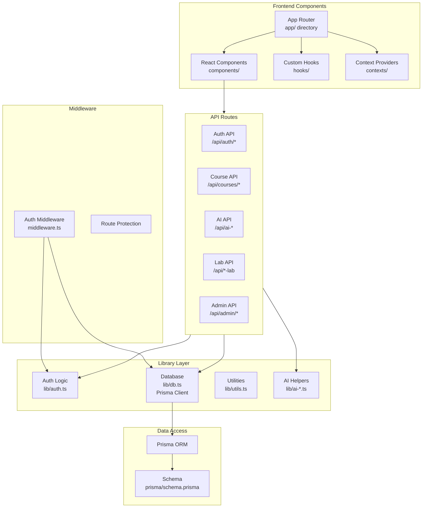
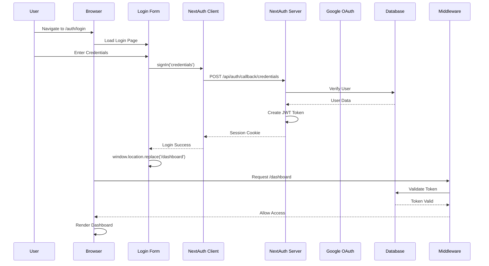
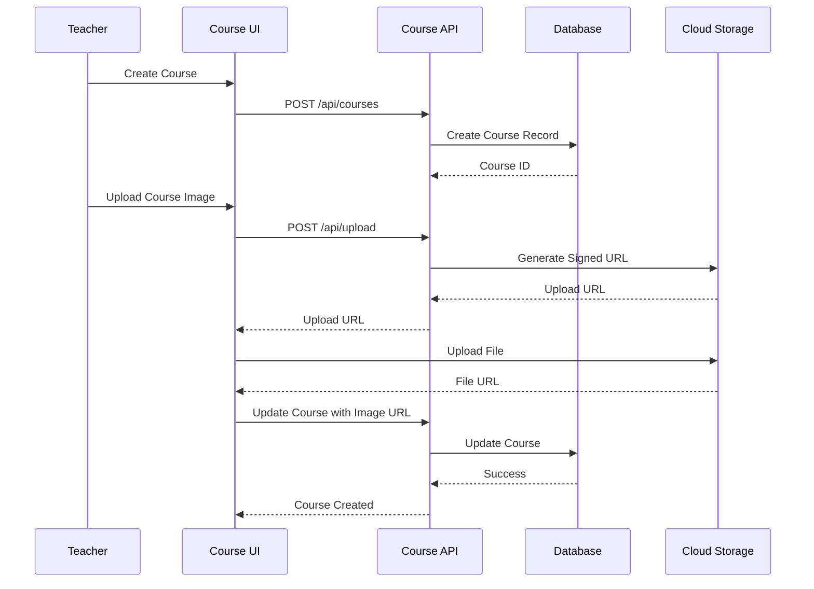
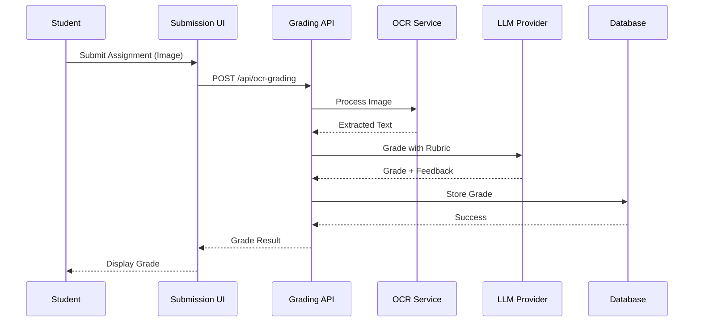
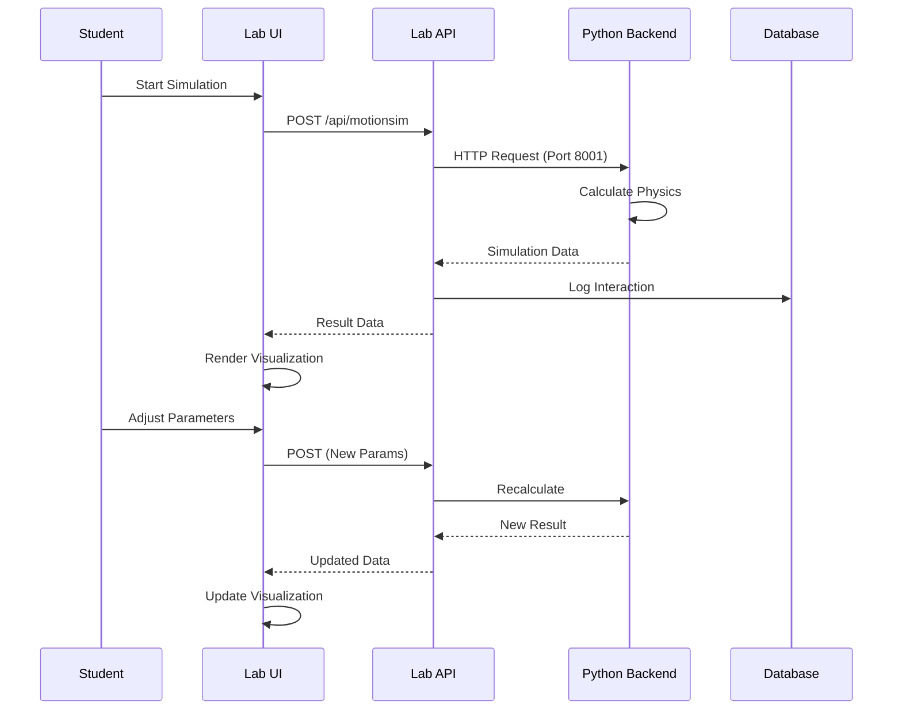
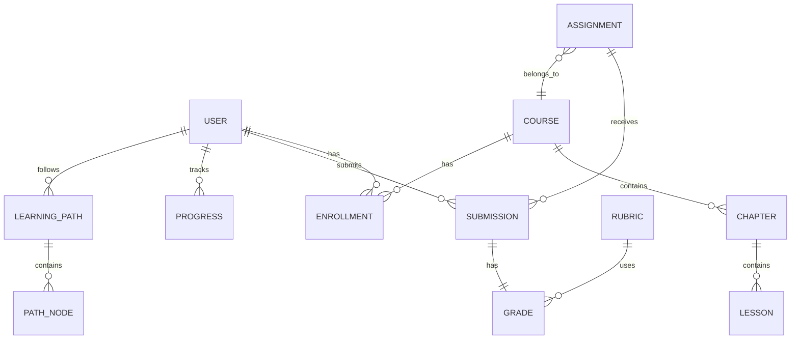
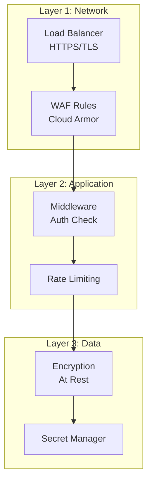
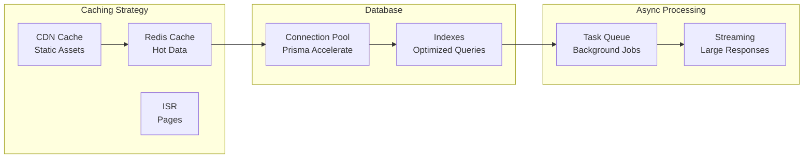
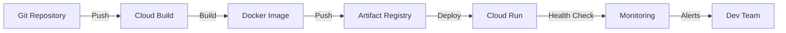

# 🏗️ Kiến Trúc Chi Tiết - Component Level

## 📦 Component Architecture

---

## 🔐 Authentication Flow Detail

---

## 📚 Course Management Flow

---

## 🤖 AI Grading Flow

---

## 🔄 Real-time Lab Simulation Flow

---

## 📊 Data Model Relationships

---

## 🔒 Security Layers

---

## 📈 Performance Optimization

---

## 🚀 Deployment Pipeline

---

**Last Updated**: 2024-12-06

