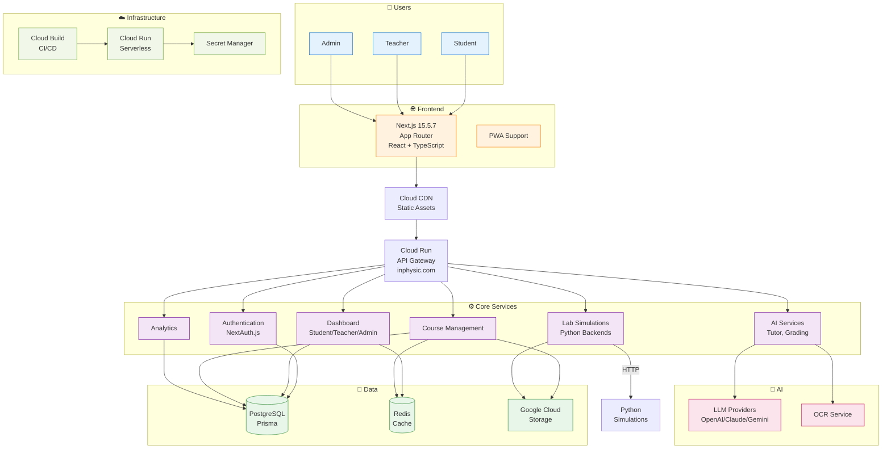

# 🏗️ Kiến Trúc Hệ Thống - Quick Reference

## 📊 Sơ Đồ Tổng Quan (Mermaid)



---

## 🎯 Thành Phần Chính

### **1. Frontend (Next.js 15.5.7)**
- **Location**: `app/` directory
- **Components**: `components/`
- **Hooks**: `hooks/`
- **Contexts**: `contexts/`
- **Features**: SSR, SSG, ISR, RSC

### **2. API Layer**
- **Routes**: `app/api/*`
- **Auth**: NextAuth.js
- **Endpoints**: 
  - `/api/auth/*` - Authentication
  - `/api/courses/*` - Course management
  - `/api/ai-*` - AI services
  - `/api/*-lab` - Lab simulations
  - `/api/admin/*` - Admin functions

### **3. Data Layer**
- **PostgreSQL**: Primary database (Prisma ORM)
- **Redis**: Cache & sessions
- **GCS**: File storage

### **4. AI Services**
- **LLM**: OpenAI, Claude, Gemini, Ollama
- **OCR**: Python OCR backend
- **Embeddings**: Vector search (future)

### **5. Infrastructure**
- **Cloud Run**: Serverless containers
- **Cloud Build**: CI/CD
- **Secret Manager**: API keys & secrets

---

## 🔄 Luồng Dữ Liệu Chính

### **Login Flow**
```
User → Login Form → NextAuth → Google OAuth
  → JWT Token → Cookie → Middleware → Dashboard
```

### **Course Access**
```
User → Dashboard → Course List → API → PostgreSQL
  → Course Data → Render → Display
```

### **Lab Simulation**
```
User → Lab Page → API → Python Backend (HTTP)
  → Simulation → Result → Display
```

### **AI Grading**
```
Student → Submit → OCR → LLM → Grade → Database
```

---

## 🔒 Bảo Mật

- ✅ HTTPS/TLS everywhere
- ✅ NextAuth.js authentication
- ✅ JWT tokens
- ✅ Role-based access (RBAC)
- ✅ Middleware protection
- ✅ Rate limiting
- ✅ Input validation
- ✅ Secret management

---

## 📈 Performance

- ✅ CDN for static assets
- ✅ Redis caching
- ✅ ISR for pages
- ✅ Connection pooling
- ✅ Auto-scaling (0-10 instances)

---

## 🚀 Deployment

```
Git → Cloud Build → Docker Image → Artifact Registry
  → Cloud Run → Load Balancer → inphysic.com
```

---

**Quick Links**:
- [Full Architecture](./ARCHITECTURE.md)
- [Detailed Components](./ARCHITECTURE_DETAILED.md)
- [Security Patch](./../SECURITY_PATCH_CVE-2025-55182.md)

