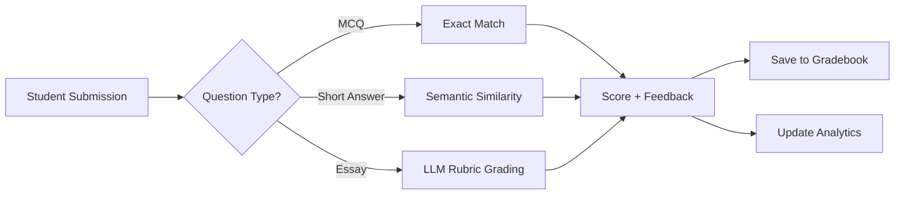

# Kiến Trúc Agents cho Aeroeduvison
## Áp dụng OpenFang Agent OS vào Hệ Thống Giáo Dục

---

## 🎯 Tổng Quan

Aeroeduvison sẽ áp dụng kiến trúc **OpenFang Agent OS** để tạo ra hệ thống tự động hóa thông minh cho 3 đối tượng:

| Đối tượng | Mục tiêu | Agents đề xuất |
|-----------|----------|----------------|
| **Học sinh** | Học tập cá nhân hóa, tiến bộ tự động | 5 Agents |
| **Giáo viên** | Giảng dạy hiệu quả, chấm điểm tự động | 7 Agents |
| **Admin** | Quản lý hệ thống, báo cáo thông minh | 4 Agents |

---

## 🏗️ Kiến Trúc Tổng Thể

```mermaid
graph TB
    subgraph "User Interfaces"
        StudentUI["Student Portal<br/>Web + Mobile"]
        TeacherUI["Teacher Portal<br/>Web + Mobile"]
        AdminUI["Admin Dashboard<br/>Web"]
    end

    subgraph "Agent Gateway"
        API["Aeroeduvison API<br/>REST/WS Endpoints"]
        Router["Agent Router<br/>Role-based Routing"]
    end

    subgraph "Student Agents"
        StudyAgent["Study Planner Agent"]
        TutorAgent["AI Tutor Agent"]
        ProgressAgent["Progress Tracker Agent"]
        ExamAgent["Exam Prep Agent"]
        CareerAgent["Career Advisor Agent"]
    end

    subgraph "Teacher Agents"
        ContentAgent["Content Generator Agent"]
        GradingAgent["Auto Grading Agent"]
        MatrixAgent["Exam Matrix Agent"]
        InsightAgent["Student Insight Agent"]
        ScheduleAgent["Schedule Planner Agent"]
        FeedbackAgent["Feedback Generator Agent"]
        ResearchAgent["Education Research Agent"]
    end

    subgraph "Admin Agents"
        MonitorAgent["System Monitor Agent"]
        ReportAgent["Analytics Report Agent"]
        ComplianceAgent["Compliance Checker Agent"]
        ResourceAgent["Resource Optimizer Agent"]
    end

    subgraph "Shared Services"
        Memory["Student Memory<br/>Learning History"]
        Knowledge["Education KG<br/>Subject Ontology"]
        Skills["Education Skills<br/>50+ Tools"]
        LLM["LLM Gateway<br/>Multi-provider"]
    end

    StudentUI --> API
    TeacherUI --> API
    AdminUI --> API
    API --> Router
    Router --> StudyAgent
    Router --> ContentAgent
    Router --> MonitorAgent
    StudyAgent --> Memory
    ContentAgent --> Knowledge
    GradingAgent --> Skills
    AllAgents --> LLM
```



---

## 👨‍🎓 Agents cho Học Sinh (5 Agents)

### 1. Study Planner Agent

**Chức năng:**
- Lập kế hoạch học tập cá nhân hóa
- Đề xuất lịch học dựa trên mục tiêu
- Nhắc nhở thông minh

**Tools:**
```rust
- calendar_management: Thêm/sửa lịch học
- goal_tracking: Theo dõi mục tiêu học tập
- reminder_system: Gửi notification
- progress_analytics: Phân tích tiến độ
```

**Manifest:**
```toml
[agent]
name = "study-planner"
display_name = "Trợ Lý Học Tập"
mode = "background"
schedule = "0 8 * * *"  # 8am daily

[capabilities]
- read:student_profile
- write:study_plan
- send:notifications
```

**Use Case:**
```
Học sinh: "Tôi muốn thi IELTS 7.0 trong 3 tháng"
Agent → Phân tích trình độ hiện tại
     → Tạo lộ trình 12 tuần
     → Lên lịch học mỗi ngày 2h
     → Gửi reminder 30 phút trước giờ học
```

---

### 2. AI Tutor Agent

**Chức năng:**
- Gia sư 1-1 cho từng môn học
- Giải thích khái niệm theo nhiều cách
- Chấm và giải thích bài tập

**Tools:**
```rust
- subject_knowledge: Truy cập education KG
- problem_solver: Giải toán/bài tập
- explanation_generator: Tạo giải thích đa cấp độ
- misconception_detector: Phát hiện hiểu lầm
```

**Agent Loop:**
```
Student Question
    ↓
Retrieve similar questions from Memory
    ↓
Generate explanation (Socratic method)
    ↓
Check understanding with follow-up
    ↓
Adapt difficulty based on response
    ↓
Save session to learning history
```

---

### 3. Progress Tracker Agent

**Chức năng:**
- Theo dõi tiến độ học tập real-time
- Phát hiện học sinh có nguy cơ tụt lại
- Đề xuất can thiệp kịp thời

**Metrics:**
```rust
struct StudentProgress {
    completion_rate: f32,      // % bài hoàn thành
    accuracy_trend: Vec<f32>,  // Accuracy 7 ngày qua
    time_spent: Duration,      // Thời gian học/tuần
    engagement_score: f32,     // 0-100
    risk_level: RiskLevel,     // Low/Medium/High
}
```

**Autonomous Actions:**
- Gửi email cho phụ huynh nếu risk = High
- Đề xuất bài tập bổ sung cho học sinh yếu
- Khen thưởng khi đạt milestone

---

### 4. Exam Prep Agent

**Chức năng:**
- Tạo đề thi thử từ ngân hàng câu hỏi
- Phân tích điểm mạnh/yếu sau mỗi đề
- Đề xuất trọng tâm ôn tập

**Workflow:**
```
1. Student selects: Subject + Grade + Exam Type
2. Agent queries Question Bank API
3. Generate exam with matrix (40-30-30)
4. Student takes exam (timed)
5. Auto-grade + analytics
6. Generate study plan for weak areas
```

**Tools:**
- `exam_generator`: Tạo đề từ matrix
- `auto_grader`: Chấm trắc nghiệm/tự luận
- `analytics_engine`: Phân tích kết quả
- `recommendation`: Đề xuất ôn tập

---

### 5. Career Advisor Agent

**Chức năng:**
- Tư vấn hướng nghiệp dựa trên sở thích/năng lực
- Đề xuất ngành học phù hợp
- Kết nối với cựu học sinh

**Data Sources:**
```rust
- student_profile: Sở thích, môn học yêu thích
- performance_data: Điểm các môn
- career_database: 500+ ngành nghề
- alumni_network: Cựu học sinh
```

**Output:**
```json
{
  "recommended_careers": [
    {
      "career": "Kỹ sư Phần mềm",
      "match_score": 92,
      "reasons": [
        "Giỏi Toán (9.5)",
        "Thích lập trình",
        "Tư duy logic tốt"
      ],
      "universities": ["Bách Khoa", "Khoa Học Tự Nhiên"],
      "alumni_contact": "anh.nguyen@company.com"
    }
  ]
}
```

---

## 👨‍🏫 Agents cho Giáo Viên (7 Agents)

### 1. Content Generator Agent

**Chức năng:**
- Soạn giáo án tự động
- Tạo bài giảng PowerPoint
- Sinh câu hỏi kiểm tra

**Skills:**
```rust
- lesson_planner: Tạo giáo án theo CV 2018
- slide_generator: Tạo slide từ nội dung
- question_generator: Sinh câu hỏi (MCQ, Đúng-Sai, Tự luận)
- rubric_creator: Tạo rubric chấm điểm
```

**Prompt Template:**
```markdown
# Lesson Plan Generator

Input:
- Subject: {subject}
- Grade: {grade}
- Topic: {topic}
- Duration: {duration} minutes
- Curriculum: {curriculum}

Output:
1. Learning Objectives (3-5 objectives)
2. Key Concepts
3. Lesson Flow:
   - Warm-up (5 min)
   - Main Activity (30 min)
   - Practice (10 min)
   - Wrap-up (5 min)
4. Assessment Methods
5. Homework Assignment
```

---

### 2. Auto Grading Agent

**Chức năng:**
- Chấm trắc nghiệm tự động
- Chấm tự luận với AI
- Tạo báo cáo chi tiết

**Grading Pipeline:**


**Rubric Grading Prompt:**
```markdown
Grade this essay based on:

Rubric:
- Content (40%): Accuracy, depth, relevance
- Structure (30%): Organization, flow, coherence
- Language (30%): Grammar, vocabulary, style

Essay: {student_essay}

Output JSON:
{
  "content_score": 0-10,
  "structure_score": 0-10,
  "language_score": 0-10,
  "total_score": 0-10,
  "feedback": "Detailed feedback..."
}
```

---

### 3. Exam Matrix Agent

**Chức năng:**
- Tạo ma trận đề thi tự động
- Đảm bảo tỉ lệ 40-30-30
- Sinh biến thể đề thi

**Implementation:**
```rust
pub struct ExamMatrixAgent {
    cognitive_ratios: CognitiveRatios, // 40-30-30
    question_bank: QuestionBank,
    topic_weights: Vec<TopicWeight>,
}

impl ExamMatrixAgent {
    pub fn generate_matrix(&self, topics: Vec<Topic>) -> Matrix {
        // Phân bổ câu hỏi theo cognitive level
        // Đảm bảo coverage tất cả topics
        // Generate 3 variants để GV lựa chọn
    }
}
```

**Đã triển khai:**
- ✅ `/api/questions/bulk-generate`
- ✅ `/teacher/question-bank`
- ✅ `/teacher/exam-matrix/create`

---

### 4. Student Insight Agent

**Chức năng:**
- Phân tích hành vi học tập
- Dự đoán kết quả thi
- Đề xuất can thiệp

**Analytics:**
```rust
struct StudentInsight {
    learning_style: LearningStyle, // Visual/Auditory/Kinesthetic
    peak_performance_time: TimeOfDay,
    struggle_topics: Vec<Topic>,
    predicted_score: f32,
    intervention_needed: bool,
}
```

**Dashboard Widget:**
```
┌─────────────────────────────────────┐
│ Class Insights                      │
├─────────────────────────────────────┤
│ 📊 Average Score: 7.8/10 (+0.5)     │
│ ⚠️  At-risk Students: 3             │
│ 🎯  Topics cần ôn: Phân số, Tỉ lệ   │
│ 📈  Improvement: +12% vs last week  │
└─────────────────────────────────────┘
```

---

### 5. Schedule Planner Agent

**Chức năng:**
- Xếp thời khóa biểu tối ưu
- Quản lý lịch dạy/bài kiểm tra
- Conflict resolution

**Constraints:**
```rust
- Teacher availability
- Room capacity
- Subject distribution
- Max hours per day
- Break between classes
```

**Algorithm:**
```
1. Collect all constraints
2. Generate initial schedule (greedy)
3. Optimize with genetic algorithm
4. Check for conflicts
5. Present top 3 options to teacher
```

---

### 6. Feedback Generator Agent

**Chức năng:**
- Tạo nhận xét học bạ tự động
- Personalized feedback cho từng HS
- Positive + Constructive balance

**Template:**
```markdown
{student_name} là một học sinh {positive_trait}.

Trong học kỳ {semester}, em đã:
- ✅ Đạt được: {achievements}
- 📈 Tiến bộ ở: {improvements}
- 🎯 Cần cố gắng: {areas_to_improve}

Giáo viên hy vọng em sẽ {expectations} trong học kỳ tới.
```

**Output Example:**
```
Nam là một học sinh chăm chỉ và ham học hỏi.

Trong học kỳ 1, em đã:
- ✅ Đạt được: Điểm trung bình 8.5, tham gia đầy đủ các hoạt động
- 📈 Tiến bộ ở: Môn Toán (từ 7.0 lên 9.0)
- 🎯 Cần cố gắng: Môn Văn cần viết nhiều hơn

Giáo viên hy vọng em sẽ phát huy tinh thần học tập và tự tin hơn trong phát biểu.
```

---

### 7. Education Research Agent

**Chức năng:**
- Tổng hợp nghiên cứu giáo dục mới
- Đề xuất phương pháp giảng dạy
- Best practices từ các trường

**Sources:**
- Google Scholar API
- ERIC Database
- Education journals
- Teacher communities

**Weekly Digest:**
```markdown
# Education Research Weekly

## Top 3 Studies This Week

1. "Gamification in Math Class" - Stanford
   Key Finding: +23% engagement với điểm hóa
   Apply: Thêm quiz tug-of-war vào bài học

2. "Spaced Repetition for Language Learning" - MIT
   Key Finding: Ôn tập 1-3-7 ngày tối ưu nhất
   Apply: Tích hợp vào AI Tutor Agent

3. "Peer Learning Effectiveness" - Harvard
   Key Finding: Học nhóm 3-4 người hiệu quả nhất
   Apply: Tạo study groups tự động
```

---

## 👔 Agents cho Admin (4 Agents)

### 1. System Monitor Agent

**Chức năng:**
- Giám sát hệ thống 24/7
- Phát hiện sự cố tự động
- Alert qua Telegram/Email/SMS

**Metrics:**
```rust
- API response time (p95 < 500ms)
- Error rate (< 1%)
- Active users
- Database connections
- Queue depth
```

**Alert Rules:**
```rust
if error_rate > 5% for 5min {
    send_alert(Severity::Critical, "High error rate detected");
}

if api_latency_p95 > 1000ms for 10min {
    send_alert(Severity::Warning, "API slow");
}
```

**Dashboard:**
```
┌──────────────────────────────────────────┐
│ System Health                           │
├──────────────────────────────────────────┤
│ 🟢 API: 99.9% uptime                    │
│ 🟢 Database: 45 connections / 100       │
│ 🟡 Queue: 123 pending (normal: <100)    │
│ 🟢 Active Users: 1,234                  │
└──────────────────────────────────────────┘
```

---

### 2. Analytics Report Agent

**Chức năng:**
- Tạo báo cáo tự động (daily/weekly/monthly)
- Phân tích xu hướng
- Export PDF/Excel

**Report Types:**
```rust
- EnrollmentReport: Sĩ số lớp, trường
- PerformanceReport: Điểm trung bình, distribution
- EngagementReport: Thời gian học, completion rate
- FinancialReport: Học phí, outstanding balance
```

**Schedule:**
```toml
[agent.schedule]
daily_report = "0 7 * * *"      # 7am daily
weekly_report = "0 8 * * 1"     # 8am Monday
monthly_report = "0 9 1 * *"    # 9am first day
```

**Sample Report:**
```markdown
# Weekly Analytics Report
## Week 12, 2026

### Key Metrics
- Total Students: 1,234 (+12 vs last week)
- Average Score: 7.8/10 (+0.3)
- Completion Rate: 87% (+2%)
- At-risk Students: 23 (-5)

### Top Performers
1. Class 10A: 8.9 average
2. Class 11B: 8.7 average
3. Class 9C: 8.5 average

### Areas of Concern
- Math grade 6: 15% below average
- Attendance rate dropping in grade 11
```

---

### 3. Compliance Checker Agent

**Chức năng:**
- Kiểm tra compliance với quy định Bộ GD
- Audit curriculum
- Generate compliance reports

**Checks:**
```rust
- Curriculum alignment (CV 2018)
- Exam matrix ratios (40-30-30)
- Teacher qualifications
- Facility requirements
- Safety protocols
```

**Audit Trail:**
```rust
struct ComplianceAudit {
    check_date: DateTime,
    check_type: CheckType,
    status: Pass/Fail/Warning,
    findings: Vec<Finding>,
    remediation_plan: Option<Plan>,
}
```

---

### 4. Resource Optimizer Agent

**Chức năng:**
- Tối ưu sử dụng phòng học
- Quản lý thiết bị dạy học
- Predict resource needs

**Optimization Goals:**
```rust
- Maximize room utilization (>80%)
- Minimize idle time
- Balance equipment distribution
- Predict maintenance needs
```

**Recommendations:**
```markdown
# Resource Optimization Report

## Room Utilization
- Current: 72% average
- Target: 85%
- Recommendation: Consolidate grade 6 classes

## Equipment
- Computers: 45/50 in use (90%)
- Projectors: 12/20 in use (60%)
- Action: Transfer 5 projectors to other campus

## Maintenance Alert
- Computer lab A: 3 machines need repair
- Science lab: Chemical inventory low
```

---

## 🔧 Shared Services

### 1. Education Memory Substrate

```rust
pub struct EducationMemory {
    // Student learning history
    sessions: SessionStore,
    
    // Knowledge graph
    concepts: ConceptGraph,
    
    // Performance tracking
    metrics: MetricsStore,
    
    // Content repository
    resources: ResourceStore,
}
```

**Data Models:**
```rust
struct LearningSession {
    student_id: String,
    subject: String,
    topic: String,
    duration: Duration,
    score: Option<f32>,
    engagement: f32,
    timestamp: DateTime,
}

struct ConceptGraph {
    nodes: Vec<Concept>,
    edges: Vec<Prerequisite>,
}

struct Concept {
    id: String,
    name: String,
    subject: String,
    grade: String,
    difficulty: f32,
}
```

---

### 2. Education Skills (50+ Tools)

**Question Bank Tools:**
```rust
- generate_questions(topic, count, type)
- grade_question(quality_score)
- import_questions(file)
- export_questions(format)
```

**Assessment Tools:**
```rust
- create_exam_matrix(subject, grade, topics)
- generate_exam_from_matrix(matrix_id)
- auto_grade_exam(exam_id, answers)
- analyze_exam_results(exam_id)
```

**Content Tools:**
```rust
- generate_lesson_plan(subject, topic, grade)
- create_slides(content)
- generate_worksheet(topic, difficulty)
- create_rubric(criteria)
```

**Analytics Tools:**
```rust
- calculate_student_metrics(student_id)
- generate_class_report(class_id)
- predict_exam_score(student_id)
- detect_learning_gaps(student_id)
```

---

### 3. LLM Gateway

**Multi-provider Support:**
```rust
pub enum LlmProvider {
    OpenAI,      // GPT-4, GPT-3.5
    Anthropic,   // Claude
    Google,      // Gemini
    Local,       // Ollama, vLLM
}

pub struct LlmGateway {
    providers: Vec<LlmProvider>,
    fallback_chain: Vec<Provider>,
    cost_tracker: CostTracker,
}
```

**Use Cases by Agent:**
```rust
// Student Agents
TutorAgent → GPT-4 (quality explanations)
StudyAgent → GPT-3.5 (simple reminders)

// Teacher Agents
ContentAgent → Claude (long context for lesson plans)
GradingAgent → GPT-4 (accurate grading)

// Admin Agents
ReportAgent → GPT-3.5 (cost-effective for reports)
```

---

## 🚀 Kế Hoạch Triển Khai

### Phase 1: Foundation (2 weeks)
- [ ] Setup Agent Kernel (Rust)
- [ ] Implement Memory Substrate
- [ ] Create LLM Gateway
- [ ] Build Education Skills

### Phase 2: Student Agents (3 weeks)
- [ ] Study Planner Agent
- [ ] AI Tutor Agent
- [ ] Progress Tracker Agent
- [ ] Exam Prep Agent
- [ ] Career Advisor Agent

### Phase 3: Teacher Agents (4 weeks)
- [ ] Content Generator Agent
- [ ] Auto Grading Agent
- [ ] Exam Matrix Agent (already done)
- [ ] Student Insight Agent
- [ ] Schedule Planner Agent
- [ ] Feedback Generator Agent
- [ ] Education Research Agent

### Phase 4: Admin Agents (2 weeks)
- [ ] System Monitor Agent
- [ ] Analytics Report Agent
- [ ] Compliance Checker Agent
- [ ] Resource Optimizer Agent

### Phase 5: Integration (2 weeks)
- [ ] Connect all agents to UI
- [ ] Add monitoring dashboard
- [ ] Performance optimization
- [ ] Security audit

---

## 📊 Expected Impact

| Metric | Before | After | Improvement |
|--------|--------|-------|-------------|
| Teacher grading time | 5h/week | 1h/week | 80% reduction |
| Lesson planning time | 3h/week | 30min/week | 83% reduction |
| Student engagement | 65% | 85% | +20 points |
| At-risk detection | Manual | Automatic | 100% coverage |
| Report generation | 2h/week | 5min/week | 96% reduction |

---

## 🔐 Security Considerations

```rust
// Student data protection
- Encrypt PII at rest (AES-256)
- Anonymize analytics data
- Parental consent for AI features
- GDPR/COPPA compliance

// Agent permissions
- Role-based access control
- Minimum privilege principle
- Audit trail for all actions
- Human-in-the-loop for sensitive ops
```

---

## 📈 Monitoring & Evaluation

**Agent Performance Metrics:**
```rust
- Response time (p95 < 2s)
- Accuracy (grading agreement > 90%)
- User satisfaction (CSAT > 4.5/5)
- Cost per interaction (< $0.01)
```

**Weekly Review:**
```markdown
# Agent Performance Review

## Top Performers
1. Auto Grading Agent: 95% accuracy
2. Content Generator: 4.8/5 CSAT

## Needs Improvement
1. Career Advisor: Low engagement (23%)
   Action: Simplify UI, add gamification

## Cost Analysis
- Total LLM cost: $234/week
- Cost per student: $0.19/week
- Budget utilization: 67%
```

