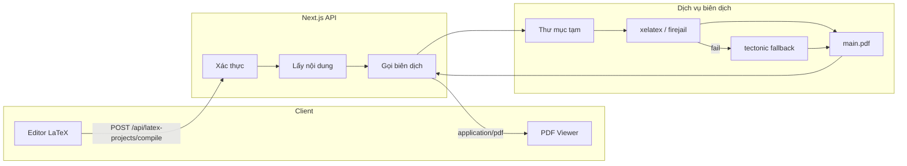
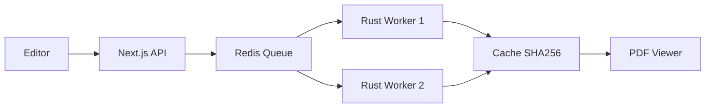

# Kiến trúc hệ thống trình biên dịch LaTeX

Tài liệu mô tả kiến trúc phần trình biên dịch LaTeX → PDF trong Aeroeduvison (Soạn LaTeX / teacher/latex-documents).

---

## 1. Tổng quan

Hệ thống cho phép giáo viên soạn mã nguồn LaTeX (`.tex`) trong trình soạn thảo và **biên dịch** sang PDF. Luồng: **Editor (client)** → **API Next.js** → **Dịch vụ biên dịch (local xelatex / tectonic)** → **PDF trả về client**. **Không phụ thuộc Docker**: primary là xelatex trên host (tùy chọn firejail trên Linux), fallback là Tectonic.



---

## 2. Các tầng thành phần

### 2.1. Client (Trình soạn thảo LaTeX)

- **Vị trí:** `app/(dashboard)/(routes)/teacher/latex-documents/[id]/page.tsx`, `components/latex-editor.tsx`
- **Chức năng:**
  - Hiển thị và chỉnh sửa `mainContent` (Monaco Editor).
  - Nút **Biên dịch** gửi `POST /api/latex-projects/compile` với `{ projectId }`.
  - Nhận response:
    - **200 + body PDF:** tạo `Blob` → `URL.createObjectURL(blob)` → hiển thị trong iframe (panel bên phải) và cung cấp Tải xuống / In.
    - **4xx/5xx:** hiển thị thông báo lỗi (ví dụ 503: dịch vụ chưa sẵn sàng; 422: lỗi biên dịch, có thể kèm `log`).
- **Không** lưu PDF lâu dài; PDF chỉ tồn tại trong phiên (blob URL) hoặc khi user tải xuống.

### 2.2. API biên dịch (Next.js)

- **Route:** `POST /api/latex-projects/compile`  
  File: `app/api/latex-projects/compile/route.ts`

**Luồng xử lý:**

1. **Xác thực:** `getServerSession(authOptions)` — chỉ user đăng nhập mới gọi được.
2. **Đầu vào:**
   - `projectId` (khuyến nghị): lấy nội dung từ `LatexProject` trong DB, kiểm tra `userId === session.user.id`.
   - Hoặc `content`: chuỗi LaTeX gửi trực tiếp (vẫn cần đăng nhập).
3. **Giới hạn:** `content.length <= 500_000` (~500KB), trả 400 nếu vượt.
4. **Gọi biên dịch:** `compileLatexToPdf(content)` từ `lib/latex-compile.ts`.
5. **Trả về:**
   - Thành công: `NextResponse(pdfBuffer)` với header `Content-Type: application/pdf`, `Content-Disposition: inline; filename="output.pdf"`.
   - Lỗi biên dịch: JSON `{ error, code, log }` với status 422 (hoặc 503 nếu dịch vụ không có).

---

## 3. Dịch vụ biên dịch (lib/latex-compile.ts)

Nhận chuỗi `.tex`, chạy engine **trên host** (không Docker), trả về buffer PDF hoặc lỗi.

### 3.1. Mô hình hoạt động (không Docker)

- **Primary:** XeLaTeX (`xelatex`) — cài trên host (vd. `texlive-xetex`, `texlive-latex-extra`). Luôn dùng `-no-shell-escape` để chống exploit.
- **Sandbox (Linux):** Nếu có **firejail**, chạy `firejail --private={work} --net=none --rlimit-cpu=90 -- xelatex ...`; nếu không có firejail thì chạy `xelatex` trực tiếp.
- **Fallback:** **Tectonic** (`tectonic main.tex`) — engine hiện đại, tự tải gói, không cần full TeX Live. Cài: `cargo install tectonic`.
- **Luồng:** 2 pass xelatex → nếu thất bại hoặc không có PDF → 1 pass tectonic → trả PDF hoặc lỗi.

### 3.2. Luồng chi tiết

```
1. Tạo thư mục tạm: tmp/latex-compile/{timestamp}-{random}/
2. Ghi file: main.tex = content (UTF-8)
3. Primary: 2 lần chạy xelatex (hoặc firejail + xelatex trên Linux)
   xelatex -interaction=nonstopmode -halt-on-error -no-shell-escape main.tex
4. Nếu có main.pdf → trả về Buffer
5. Fallback: chạy tectonic main.tex → đọc main.pdf
6. Nếu vẫn không có PDF: trả về { error, code: "COMPILE_ERROR", log }
7. Cleanup: xóa recursive tmpDir (luôn trong finally)
```

- **Timeout:** 90 giây. Nếu vượt → `COMPILE_TIMEOUT`.
- **Buffer stdout/stderr:** tối đa 2MB để lưu log.

### 3.3. Mã lỗi và ý nghĩa

| Code | Ý nghĩa |
|------|--------|
| (không có) | Thành công, có `pdf` Buffer. |
| `COMPILE_ERROR` | Engine chạy nhưng không tạo được PDF (lỗi cú pháp, thiếu gói, v.v.); `log` chứa stdout/stderr. Gợi ý cài TeX Live hoặc Tectonic. |
| `COMPILE_TIMEOUT` | Chạy quá 90s, process bị kill. |

---

## 4. Bảo mật và giới hạn

- **Quyền:** Chỉ user sở hữu project (`userId`) mới được biên dịch theo `projectId`; nếu gửi `content` thì vẫn phải đăng nhập.
- **Kích thước:** Giới hạn 500KB nội dung, tránh tốn tài nguyên và DoS đơn giản.
- **Cách ly:** Luôn dùng `-no-shell-escape` (chống `\write18`, `\input` tùy ý). Trên Linux có thể dùng **firejail** (--private, --net=none, --rlimit-cpu) để sandbox nhẹ, không cần Docker.
- **Tài nguyên:** Timeout 90s; thư mục tạm xóa sau mỗi lần biên dịch; PDF chỉ đọc vào memory rồi trả response.

---

## 5. Phụ thuộc vận hành (không Docker)

- **TeX Live (khuyến nghị):** Trên host cài ít nhất `xelatex` (vd. Ubuntu: `sudo apt install texlive-xetex texlive-latex-extra`). Hỗ trợ Unicode/tiếng Việt. Không cần Docker.
- **Hoặc Tectonic:** `cargo install tectonic` — fallback hoặc engine chính; tự tải gói. **Firejail (tùy chọn, Linux):** `sudo apt install firejail` để sandbox. **File system:** Thư mục `tmp/latex-compile` (trong `process.cwd()`) phải ghi được; xóa sau mỗi lần biên dịch.

---

## 6. Tóm tắt luồng dữ liệu

1. User bấm **Biên dịch** trên trang Soạn LaTeX.
2. Client gửi `POST /api/latex-projects/compile` với `{ projectId }`.
3. API xác thực session, lấy `mainContent` từ DB (theo `projectId` và `userId`), kiểm tra độ dài.
4. API gọi `compileLatexToPdf(content)`:
   - Tạo thư mục tạm, ghi `main.tex`.
   - Chạy **xelatex** trên host (hoặc firejail + xelatex trên Linux); nếu thất bại chạy **tectonic**.
   - Đọc `main.pdf`, xóa thư mục tạm.
5. API trả về:
   - 200 + PDF binary → client tạo blob URL, hiển thị trong iframe và cung cấp Tải xuống / In.
   - 4xx/5xx + JSON (error, code, log) → client hiển thị lỗi.

Toàn bộ kiến trúc: **client (editor + PDF viewer)**, **API (xác thực + giới hạn + gọi compile)**, **lib/latex-compile (local xelatex ± firejail + tectonic fallback, không Docker)**.

---

## 7. (Tùy chọn) Rust LaTeX Compile Service — kiến trúc kiểu Overleaf

Có thể thay **lib/latex-compile.ts** bằng một dịch vụ Rust chạy tách, hỗ trợ **queue**, **nhiều worker**, **cache nội dung** và **sandbox** chuẩn production.

### 7.1. Vị trí và cấu trúc

- **Repo:** `latex-compiler/` (Rust, Cargo).
- **Module:** `server`, `worker`, `compiler`, `sandbox`, `cache`, `storage`, `config`.

### 7.2. Luồng tổng quát



- **Next.js** có thể gọi:
  - **POST /compile/sync** (đồng bộ): body `{ "content": "..." }` → trả về PDF binary. Drop-in thay `compileLatexToPdf`.
  - **POST /compile** (bất đồng bộ): trả về `job_id`; client hoặc API poll **GET /job/:job_id** để lấy `done` (pdf_base64) hoặc `failed` (log).

### 7.3. Sandbox (Rust service: không Docker)

- LaTeX nguy hiểm nếu không sandbox (vd. `\write18{rm -rf /}`, `\input{/etc/passwd}`).
- Rust service chạy **xelatex trên host** (không Docker):
  - **Linux:** thử **firejail** trước (`--private=work`, `--net=none`, `--rlimit-cpu=90`), nếu không có firejail thì chạy xelatex trực tiếp.
  - **Fallback engine:** tectonic.
- **Bắt buộc** `-no-shell-escape` khi gọi xelatex.

### 7.4. Cache compile

- **Key:** `latex:pdf:{sha256(content)}`, **value:** PDF binary, TTL (vd. 1h).
- Nếu cache hit → trả PDF ngay, không gọi xelatex → giảm tải rất lớn khi nội dung trùng (vd. 90% hit).

### 7.5. Pipeline compile

- 2 pass **xelatex** (đủ TOC/cross-ref cơ bản); có thể mở rộng thêm bibtex nếu cần.

### 7.6. Tối ưu có thể thêm sau

| Ý tưởng | Mô tả |
|--------|--------|
| Persistent tex tree | Load package một lần, giảm thời gian mỗi lần compile. |
| Precompiled format | `xelatex -ini` → `latex.fmt`, sau đó `xelatex -fmt=latex.fmt` → nhanh hơn nhiều. |
| Warm workers | Worker luôn chạy, không cold start. |
| RAM disk | Thư mục compile dùng `/dev/shm` (Linux) → IO nhanh. |
| MinIO / S3 | Lưu PDF lên object storage, trả URL thay vì base64 trong Redis. |

### 7.7. Production stack đề xuất

| Thành phần | Công nghệ |
|------------|------------|
| Frontend | Next.js |
| Queue | Redis |
| Compile | Rust (latex-compiler) |
| Sandbox | Docker |
| Cache | Redis |
| Storage (tùy chọn) | MinIO / S3 |

### 7.8. Tích hợp với Next.js

- **Sync (giữ hành vi hiện tại):** Trong `app/api/latex-projects/compile/route.ts`, thay `compileLatexToPdf(content)` bằng HTTP `POST {LATEX_SERVICE_URL}/compile/sync` với body `{ "content": content }`, đọc response body là PDF. Cần Redis + dịch vụ Rust đang chạy (không bắt buộc Docker).
- **Async:** Gọi `POST /compile` → nhận `job_id` → poll `GET /job/:job_id` đến khi `done` hoặc `failed` → trả PDF (decode base64) hoặc lỗi cho client.

Chi tiết chạy dịch vụ, API và biến môi trường: xem **latex-compiler/README.md**.
