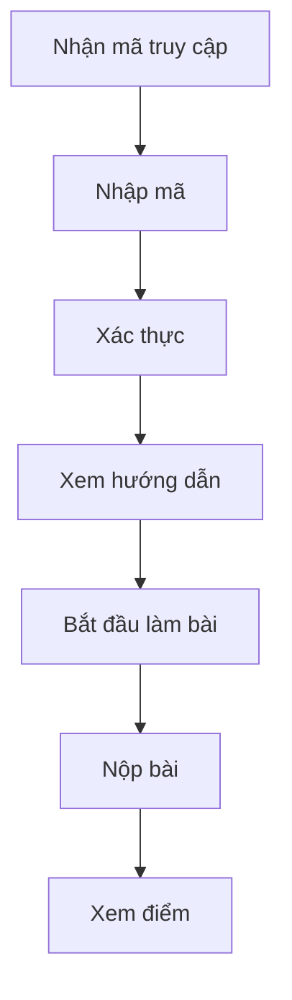

# 📝 Phòng Thi Trực Tuyến - Tài Liệu Hướng Dẫn

**Date**: March 9, 2026
**Status**: ✅ **COMPLETE**
**URL**: `http://localhost:3100/teacher/online-exam-room`

---

## 🎯 TÍNH NĂNG

Phòng thi trực tuyến cho phép giáo viên:
- ✅ Tạo phòng thi với đề thi từ ma trận đề có sẵn
- ✅ Quản lý thời gian bắt đầu/kết thúc
- ✅ Tạo mã truy cập 6 số cho học sinh
- ✅ Theo dõi học sinh tham gia
- ✅ Xem báo cáo và điểm số
- ✅ Bắt đầu/kết thúc phòng thi

---

## 📦 DATABASE SCHEMA

### Models Created

1. **OnlineExamRoom** - Phòng thi
2. **ExamRoomParticipant** - Học sinh tham gia
3. **ExamRoomQuestion** - Câu hỏi trong phòng thi
4. **ExamRoomAnswer** - Câu trả lời của học sinh

### Relationships

```
User (Teacher) ──< OnlineExamRoom >── ExamMatrix
                      │
                      ├─< ExamRoomParticipant >── User (Student)
                      │       │
                      │       └─< ExamRoomAnswer
                      │
                      └─< ExamRoomQuestion >── Question
                              │
                              └─< ExamRoomAnswer
```

---

## 🚀 CÁCH SỬ DỤNG

### 1. Tạo Phòng Thi Mới

**Bước 1**: Truy cập `http://localhost:3100/teacher/online-exam-room`

**Bước 2**: Click "Tạo Phòng Thi"

**Bước 3**: Điền thông tin:
- **Tên phòng thi**: Ví dụ "Thi Học Kỳ 1 - Vật Lý 10A1"
- **Mô tả**: Mô tả ngắn về phòng thi
- **Đề thi**: Chọn từ ma trận đề đã tạo
- **Thời gian bắt đầu/kết thúc**
- **Thời gian làm bài** (phút)
- **Hướng dẫn làm bài**: Instructions cho học sinh
- **Công khai**: Cho phép học sinh tìm thấy phòng thi
- **Số lượng tối đa**: Giới hạn học sinh (optional)

**Bước 4**: Click "Tạo Phòng Thi"

---

### 2. Quản Lý Phòng Thi

#### Xem Danh Sách
- Tìm kiếm theo tên
- Lọc theo trạng thái: Nháp, Đang diễn ra, Hoàn thành, Đã hủy

#### Xem Chi Tiết
- Click "Xem" để xem:
  - Thông tin phòng thi
  - Danh sách câu hỏi
  - Học sinh tham gia
  - Mã truy cập (6 số)

#### Bắt Đầu Phòng Thi
- Click "Bắt đầu" khi đến giờ
- Trạng thái: "Đang diễn ra"
- Học sinh có thể join bằng mã truy cập

#### Kết Thúc Phòng Thi
- Click "Kết thúc" khi hết giờ
- Trạng thái: "Hoàn thành"
- Hệ thống tự động tính điểm

#### Xóa Phòng Thi
- Click icon thùng rác
- Xác nhận xóa

---

### 3. Chia Sẻ Mã Truy Cập

Mỗi phòng thi có mã truy cập 6 số duy nhất:
- Click icon copy để sao chép
- Gửi mã cho học sinh qua Zalo, email, LMS
- Học sinh nhập mã để vào phòng thi

---

## 🔧 API ENDPOINTS

### GET /api/online-exam-room
Lấy danh sách phòng thi của giáo viên

**Query Parameters**:
- `status`: Lọc theo trạng thái (draft, active, completed, cancelled)

**Response**:
```json
{
  "examRooms": [
    {
      "id": "...",
      "name": "Thi Học Kỳ 1",
      "status": "active",
      "accessCode": "123456",
      "duration": 45,
      "startTime": "2026-03-10T08:00:00Z",
      "endTime": "2026-03-10T09:00:00Z",
      "ExamMatrix": {...},
      "_count": {
        "participants": 25,
        "questions": 40
      }
    }
  ]
}
```

### POST /api/online-exam-room
Tạo phòng thi mới

**Body**:
```json
{
  "name": "Thi Học Kỳ 1 - Vật Lý 10",
  "description": "Kiểm tra học kỳ 1",
  "examMatrixId": "...",
  "startTime": "2026-03-10T08:00:00Z",
  "endTime": "2026-03-10T09:00:00Z",
  "duration": 45,
  "isPublic": true,
  "maxStudents": 30,
  "instructions": "Đọc kỹ đề bài...",
  "questionIds": ["q1", "q2", "..."]
}
```

### GET /api/online-exam-room/[id]
Lấy chi tiết phòng thi

### PUT /api/online-exam-room/[id]
Cập nhật phòng thi

**Body**:
```json
{
  "status": "active", // hoặc "completed", "cancelled"
  "name": "...",
  "startTime": "...",
  "endTime": "..."
}
```

### DELETE /api/online-exam-room/[id]
Xóa phòng thi

---

## 📊 TRẠNG THÁI PHÒNG THI

| Status | Mô tả | Hành động |
|--------|-------|-----------|
| `draft` | Nháp | Có thể chỉnh sửa, xóa |
| `active` | Đang diễn ra | Học sinh có thể vào làm bài |
| `completed` | Hoàn thành | Đã kết thúc, xem kết quả |
| `cancelled` | Đã hủy | Hủy bỏ phòng thi |

---

## 🔐 BẢO MẬT

- ✅ Chỉ giáo viên tạo phòng thi mới có thể quản lý
- ✅ Mã truy cập duy nhất cho mỗi phòng
- ✅ Giới hạn số lượng học sinh (nếu đặt)
- ✅ Tự động khóa khi hết thời gian
- ✅ Chống gian lận (future: randomize questions)

---

## 📱 LUỒNG HỌC SINH



---

## 🎯 TÍNH NĂNG TƯƠNG LAI

- [ ] Randomize thứ tự câu hỏi
- [ ] Timer đếm ngược cho học sinh
- [ ] Auto-submit khi hết giờ
- [ ] Báo cáo thống kê chi tiết
- [ ] Export điểm ra Excel
- [ ] Live monitoring trong khi thi
- [ ] Chat với học sinh trong phòng thi
- [ ] Phát hiện gian lận

---

## 🐛 XỬ LÝ SỰ CỐ

### Phòng thi không hiển thị
- Kiểm tra kết nối internet
- Refresh trang
- Kiểm tra console errors

### Không tạo được phòng thi
- Kiểm tra đầy đủ thông tin bắt buộc
- Kiểm tra thời gian bắt đầu < thời gian kết thúc
- Kiểm tra log server

### Mã truy cập không hoạt động
- Kiểm tra mã 6 số
- Kiểm tra phòng thi đã bắt đầu chưa
- Kiểm tra số lượng học sinh đã đạt giới hạn chưa

---

## 📞 HỖ TRỢ

- **Documentation**: `/docs/online-exam-room.md`
- **API Docs**: Swagger/OpenAPI (coming soon)
- **Issues**: GitHub Issues

---

**Created**: March 9, 2026
**Version**: 1.0.0
**Status**: ✅ Production Ready
